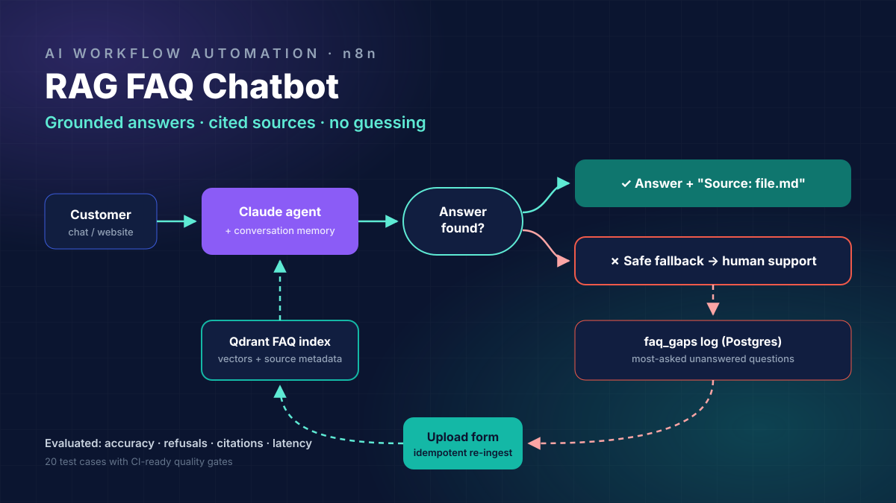
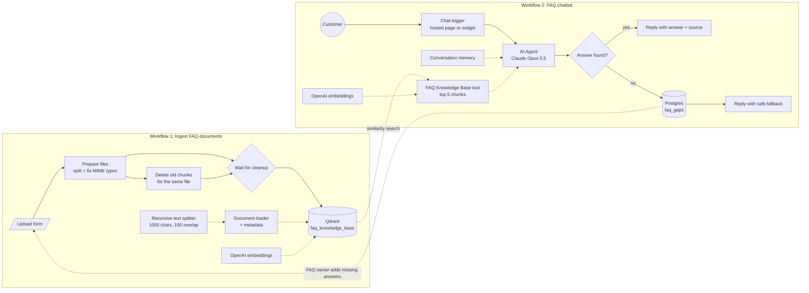

# RAG FAQ Chatbot (n8n + Claude + Qdrant)



A customer-support chatbot that answers **only from your FAQ documents**, cites its sources, refuses to guess, and turns every unanswered question into a to-do item for the FAQ owner.

Built end to end in **n8n** with **Claude** (Anthropic) for answers, **OpenAI embeddings**, **Qdrant** as the vector database and **PostgreSQL** for analytics. It ships with a sample knowledge base for *Contoso Pay*, a **fictional** digital wallet.

| | |
|---|---|
| **Category** | AI Workflow Automation · Retrieval-Augmented Generation (RAG) |
| **Stack** | n8n 2.47 · Claude Opus 5.5 · OpenAI `text-embedding-3-small` · Qdrant 1.20 · PostgreSQL 16 · Docker Compose · Python (evaluation) |
| **Status** | Workflows checked against n8n 2.47 node definitions. Run the evaluation (step 7) to produce accuracy figures for your own setup. |

---

## Why this project

Most FAQ chatbots fail in one of two ways: they **make up answers** (a fee, a limit, a policy that doesn't exist), or they **go stale** as the FAQ changes. Both are data-quality problems, not model problems. This build treats them that way:

| Risk | How this chatbot handles it |
|---|---|
| Hallucinated answers | Claude is told to answer only from retrieved FAQ passages and return `[NO_ANSWER]` otherwise. The workflow replaces that with a safe fallback message instead of a guess. |
| Untraceable answers | Every chunk carries `source`, `category` and `ingestedAt` metadata, and answers end with `Source: <file>`. |
| Duplicate / outdated knowledge | Re-uploading a document **deletes its old chunks first**, so the vector store never holds two versions of the same answer. |
| Knowledge gaps nobody sees | Unanswered questions are logged to Postgres (`faq_gaps`), with a ready-made report of the most-asked gaps. |
| Silent quality regressions | A 20-case evaluation suite measures answer accuracy, refusal accuracy, citation rate and latency, with pass/fail quality gates. |
| Prompt injection / sensitive data | The system prompt treats retrieved text as data, not instructions, and the bot never asks for PINs, passwords or one-time codes. |

---

## Architecture



The loop at the bottom is the point: **questions the bot can't answer become new FAQ content**, which is uploaded through the same form.

---

## What's in this folder

```
01-rag-faq-chatbot/
├── workflows/
│   ├── 01-ingest-faq-documents.json   # import into n8n
│   └── 02-faq-chatbot.json            # import into n8n
├── knowledge-base/                    # sample FAQ for fictional "Contoso Pay" (4 Markdown files)
├── evaluation/
│   ├── test-cases.csv                 # 16 in-scope + 4 out-of-scope questions with expected facts
│   └── evaluate.py                    # runs the suite against the live bot, writes a report
├── widget/index.html                  # embed the chatbot on any web page
├── assets/architecture.svg            # diagram used in this README
├── init-db/01-faq-analytics.sql       # creates faq_gaps table + gap report view
├── docker-compose.yml                 # n8n + Qdrant + Postgres
└── .env.example
```

---

## Setup (about 15 minutes)

### Prerequisites
- **Docker Desktop**
- An **Anthropic API key** (console.anthropic.com) for answers
- An **OpenAI API key** (platform.openai.com) for embeddings
- Python 3.9+ (only for the evaluation script)

### 1. Start the stack
```bash
cd projects/01-rag-faq-chatbot
cp .env.example .env        # then set POSTGRES_PASSWORD and N8N_ENCRYPTION_KEY
docker compose up -d
```
- n8n: http://localhost:5678 (create the owner account on first visit)
- Qdrant dashboard: http://localhost:6333/dashboard

> Already running n8n on port 5678? Set `N8N_PORT=5679` in `.env`, and use that port in every URL below.

### 2. Import the workflows
In n8n: **Overview → Create → Import from file**, and import both files from `workflows/`.

### 3. Create the credentials
Open each workflow and click any node with a warning icon, then **Create new credential**:

| Credential | Used by | Values |
|---|---|---|
| **Anthropic** | `Claude` | Your Anthropic API key |
| **OpenAI** | both `OpenAI Embeddings` nodes | Your OpenAI API key |
| **Qdrant** | `Store in Qdrant`, `FAQ Knowledge Base` | URL `http://qdrant:6333`, API key empty |
| **Postgres** | `Log unanswered question` | Host `postgres`, database `faq_analytics`, user and password from `.env`, port `5432`, SSL off |

### 4. Load the knowledge base
1. Open **RAG FAQ · 1. Ingest FAQ documents** and click **Test workflow** (or activate it and use the production form URL).
2. In the form, upload the four files from `knowledge-base/` and submit.
3. The last node shows `filesIndexed: 4` and the number of chunks stored. In the Qdrant dashboard, the collection `faq_knowledge_base` appears.

### 5. Chat with it
Open **RAG FAQ · 2. FAQ chatbot** and click **Activate**. Then either:
- click **Open chat** in the editor, or
- open the public chat page: `http://localhost:5678/webhook/b1d4d570-9e03-5304-9c01-8854082a24ee/chat`

Try: *"How much is an instant withdrawal?"*, *"I lost my phone"*, and something off-topic like *"What's the price of Bitcoin?"*.

### 6. Embed it on a website
Open `widget/index.html` in a browser. It loads the official `@n8n/chat` widget and connects to the same webhook. Copy the `<script>` block into any site. For production, set the Chat Trigger's **Allowed Origins** to your domain instead of `*`.

### 7. Run the evaluation
```bash
cd evaluation
python evaluate.py --url http://localhost:5678/webhook/b1d4d570-9e03-5304-9c01-8854082a24ee/chat
```
The script sends all 20 questions (each in a fresh session), grades them, prints a summary and writes `results/<timestamp>.md` and `.csv`. It exits with code 1 when a quality gate fails (defaults: ≥ 85 % answer accuracy, 100 % refusal accuracy), so it can run in CI after any change to the prompt, model or documents.

| Metric | What it checks |
|---|---|
| Answer accuracy | In-scope question answered and every expected fact present (e.g. `1.5%` and `$15`) |
| Refusal accuracy | Out-of-scope question gets the fallback instead of an invented answer |
| Citation rate | Answers that end with `Source: <file>` |
| Latency avg / p95 | Customer-perceived response time |

### 8. Review knowledge gaps
```bash
docker compose exec postgres psql -U n8n -d faq_analytics -c "SELECT * FROM faq_gap_report;"
```
Write FAQ entries for the top gaps, upload the updated file through the form, then mark them done:
```sql
UPDATE faq_gaps SET status = 'added_to_faq' WHERE question ILIKE '%savings%';
```

---

## Using your own FAQ

1. Replace the files in `knowledge-base/` with your own (Markdown works best: one `##` heading per question).
2. In the chatbot workflow, edit the **FAQ Assistant** system message and the **FAQ Knowledge Base** tool description to name your company and topics, and update the fallback text in **Reply with fallback**.
3. Update `evaluation/test-cases.csv` with your own questions and the facts each answer must contain.

## Configuration options

| Change | Where | Notes |
|---|---|---|
| Model | `Claude` node → Model | Default `claude-opus-5-5` (most capable). `claude-haiku-5-5` is far cheaper and faster, and is usually enough for FAQ-style answers. Re-run the evaluation after switching. Thinking Mode must stay **Adaptive**: Opus 5.5 rejects disabled thinking. |
| Answer depth | `Claude` node → Effort | `low` keeps answers fast and cheap. Raise it only if the evaluation shows the model missing facts. |
| Chunks retrieved | `FAQ Knowledge Base` → Limit (`topK`) | 5 by default. More gives more context but costs more tokens. |
| Chunk size | `Text Splitter` | 1000 / 150. Smaller chunks give more precise retrieval for short FAQ entries. |
| Fully local embeddings | Replace both embedding nodes with **Embeddings Ollama** (`nomic-embed-text`) | Removes the OpenAI dependency. Re-ingest everything: vectors from different models are not compatible. |
| Managed vector DB | Qdrant credential → your Qdrant Cloud URL + API key | Also update the URL in **Remove previous version**. |

### Approximate running cost
Each question makes about two model calls (search, then answer), with roughly 4,000 input and 300 output tokens in total. At Anthropic's published rates this is about **$0.02 per question on Claude Opus 5.5** and **under $0.001 on Claude Haiku 5.5**. Embedding cost is negligible. These are estimates: check the token usage in n8n's execution log for real numbers.

## Security & governance notes
- **Secrets** live in n8n's encrypted credential store (`N8N_ENCRYPTION_KEY`), never in the workflow files. Exported workflows in this repo contain no credentials.
- The chat endpoint is **public** for demo purposes. For production, enable the Chat Trigger's authentication or restrict **Allowed Origins**.
- Chat sessions are kept in short-term memory only (last 6 turns). The `faq_gaps` table stores question text: avoid logging personal data, or add redaction before the Postgres node if your users might paste it.
- Retrieved FAQ text is treated as reference data in the system prompt, which limits prompt injection through documents.

## Troubleshooting

| Problem | Fix |
|---|---|
| `Unsupported mime type` during ingestion | Use .md, .txt, .pdf, .docx, .csv or .json. The *Prepare files* node sets the type from the extension. |
| Chat says "Workflow could not be started" | The chatbot workflow isn't **active**, or a credential is missing. |
| Every answer is the fallback | The knowledge base is empty (run step 4), or the Qdrant collection name differs between the two workflows (`faq_knowledge_base`). |
| `Model does not support disabling thinking` | In the `Claude` node, set Thinking Mode to **Adaptive**. |
| `relation "faq_gaps" does not exist` | The init script only runs on a fresh volume: `docker compose down -v && docker compose up -d` (this deletes all data), or run `init-db/01-faq-analytics.sql` manually. |

## Roadmap
- Hybrid search (keyword + vector) for exact product names and codes
- Answer-quality feedback buttons (👍/👎) logged next to the gap table
- Scheduled re-ingestion from Google Drive or a docs repository
- LLM-as-judge grading in the evaluation suite for free-text answers

---

Part of [AI Workflow Automation](../../README.md) by **Trevor Kauyu**.
