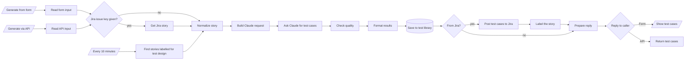

# Build guide: the Jira test-case generator, step by step

This guide rebuilds the workflow by hand in the n8n editor, node by node. Use it to learn how the workflow works, to explain it in an interview, or to adapt it for your own team.

If you only want to *run* the project, import `workflows/01-generate-test-cases.json` instead (see the [README](README.md)). The result of this guide is the same workflow.

**Time:** about 60–90 minutes.  **Level:** comfortable with n8n basics (adding nodes, connecting them, expressions).

---

## Contents

- [What you will build](#what-you-will-build)
- [Before you start](#before-you-start)
- [Part A. Inputs](#part-a-inputs-steps-17): form, API, Jira lookup, normalization
- [Part B. Generation](#part-b-generation-steps-810): asking Claude for test cases
- [Part C. Quality and outputs](#part-c-quality-and-outputs-steps-1115): checks, formats, database, Jira
- [Part D. Replies](#part-d-replies-steps-1619): results page and API response
- [Part E. Automation](#part-e-automation-step-20): the scheduled Jira scan
- [Part F. Test, publish, export](#part-f-test-publish-and-export-steps-2123)
- [Concepts worth understanding](#concepts-worth-understanding)
- [Common mistakes](#common-mistakes)

---

## What you will build

Twenty-one nodes in five parts. The pattern is reusable for most "AI does a document task" workflows:
1. **Inputs:** accept work from several places and turn it into one clean shape.
2. **Generation:** one well-specified model call that returns structured data.
3. **Quality gate:** deterministic code checks the model's work before anyone relies on it.
4. **Outputs:** the same result formatted for each destination (Jira, database, people, other systems).
5. **Replies:** answer whoever asked.

> **Node names matter.** Several Code nodes and expressions refer to other nodes by name, for example `$('Format results')`. Name every node **exactly** as written in this guide. Renaming a node later is safe in the editor, because n8n updates references for you, but a typo when you first name it is not caught.

---

## Before you start

1. **Start the stack:** follow README steps 1–2, so n8n runs at `http://localhost:5678` and the `qa_testgen` database exists.
2. **Create the credentials:** in n8n, go to **Overview → Credentials → Create credential**:

   | Credential type | Name it | Values |
   |---|---|---|
   | **Anthropic** | `Anthropic` | Your API key from console.anthropic.com |
   | **Postgres** | `Postgres qa_testgen` | Host `postgres` · Database `qa_testgen` · User and Password from your `.env` · Port `5432` · SSL `disable` |
   | **Jira SW Cloud API** | `Jira` | Email of your Atlassian account · API token from id.atlassian.com → Security → API tokens · Domain `https://<your-site>.atlassian.net` |

   No Jira yet? Skip the Jira credential. Everything except Steps 6, 14, 15 and 20 works without it.
3. **Create the workflow:** go to **Overview → Create workflow** and name it `QA TestGen · 1. Generate test cases from Jira stories`.
4. Keep the `workflows/code/` folder open. You will paste five code files from it.

---

## Part A. Inputs (Steps 1–7)

### Step 1. Form trigger: `Generate from form`

**Add node → On form submission** (the *n8n Form Trigger*).

| Setting | Value |
|---|---|
| Form Title | `Generate test cases` |
| Form Description | `Enter a Jira issue key to read the story from Jira and post the test cases back to it.` (new line) `No Jira yet? Leave the key empty and paste a story below.` |
| Respond When | `Form Is Submitted` (the default; the Form Ending node in Step 18 takes over the response) |
| Options → Submit Button Label | `Generate test cases` |

Add four form elements:

| Field Label | Element Type | Placeholder | Required |
|---|---|---|---|
| `Jira issue key` | Text | `e.g. CPAY-12 (optional)` | off |
| `Story title` | Text | `e.g. Lock the account after repeated failed sign-in attempts` | off |
| `Story description` | Textarea | `As a ... I want ... so that ...` | off |
| `Acceptance criteria` | Textarea | `One criterion per line` | off |

Rename the node to **`Generate from form`**.

*Why nothing is required:* a user fills in either the key or the story, never both. Step 7 rejects a completely empty submission with a clear message.

### Step 2. `Read form input` (Edit Fields)

**Add node → Edit Fields (Set)** after the form. Mode **Manual Mapping**. Add four fields:

| Name | Type | Value (expression) |
|---|---|---|
| `issueKey` | String | `{{ ($json['Jira issue key'] ?? '').trim().toUpperCase() }}` |
| `summary` | String | `{{ $json['Story title'] ?? '' }}` |
| `description` | String | `{{ $json['Story description'] ?? '' }}` |
| `acceptanceCriteria` | String | `{{ $json['Acceptance criteria'] ?? '' }}` |

*Why:* form field names contain spaces and depend on the labels. Mapping them to simple names here means the rest of the workflow never depends on how the form is worded.

### Step 3. API trigger: `Generate via API`

**Add node → Webhook** (a second trigger, separate from the form).

| Setting | Value |
|---|---|
| HTTP Method | `POST` |
| Path | `qa-testgen/generate` |
| Authentication | `None` for the local demo (see *Security* in the README for production) |
| Respond | `When Last Node Finishes` |
| Response Data | `First Entry JSON` |

Rename it **`Generate via API`**.

*Why "When Last Node Finishes" and not a Respond to Webhook node:* n8n refuses to start a **form**-triggered workflow that contains a *Respond to Webhook* node (the error is *"The Respond to Webhook node is not supported in workflows initiated by the n8n Form Trigger"*). Replying with the last node's output avoids the conflict. Step 19 makes sure the last node holds the API answer.

### Step 4. `Read API input` (Edit Fields)

After the webhook, add **Edit Fields (Set)**, Manual Mapping:

| Name | Type | Value (expression) |
|---|---|---|
| `issueKey` | String | `{{ String($json.body.issueKey ?? '').trim().toUpperCase() }}` |
| `summary` | String | `{{ $json.body.summary ?? '' }}` |
| `description` | String | `{{ $json.body.description ?? '' }}` |
| `acceptanceCriteria` | **Array** | `{{ [].concat($json.body.acceptanceCriteria ?? []) }}` |

*Why `[].concat(...)`:* API callers may send the criteria as a list *or* as one text block. This wraps either into an array, and Step 7 splits text into lines.

### Step 5. `Jira issue key given?` (If)

Add an **If** node and connect **both** `Read form input` and `Read API input` into it.

- Condition: `{{ $json.issueKey }}` → **String → is not empty**

The **true** branch fetches the story from Jira. The **false** branch uses the pasted story.

### Step 6. `Get Jira story` (Jira Software)

On the **true** output, add **Jira Software → Issue → Get**.

| Setting | Value |
|---|---|
| Credential | `Jira` |
| Jira Version | `Cloud` |
| Issue Key | `{{ $json.issueKey }}` |
| Simplify | off |

### Step 7. `Normalize story` (Code)

Add a **Code** node. Connect **three** inputs into it:
- the **false** output of `Jira issue key given?`
- the output of `Get Jira story`
- (later, in Step 20) `Find stories labelled for test design`

| Setting | Value |
|---|---|
| Mode | **Run Once for All Items** |
| Language | JavaScript |
| Code | paste the whole of [`workflows/code/1-normalize-story.js`](workflows/code/1-normalize-story.js) |

What it does:
- detects which trigger started the run (`$('Generate from form').isExecuted`), so the reply goes back to the right place;
- reads either a Jira issue or a pasted story into one shape: `issueKey, summary, description, acceptanceCriteria[], labels, components, fromJira, channel`;
- converts Jira's *Atlassian Document Format* (a JSON tree) into plain text;
- finds an **"Acceptance criteria"** section in the description (Markdown, Jira wiki or plain text), or reads a custom field if you set `AC_CUSTOM_FIELD`;
- numbers the criteria `AC1, AC2, ...`. These ids are the backbone of traceability.

✅ **Checkpoint 1.** Click **Execute workflow** and submit the test form with only a title and two acceptance criteria. Open `Normalize story`. You should see one item with `acceptanceCriteria: [{id: "AC1", ...}, {id: "AC2", ...}]` and `channel: "form"`.

---

## Part B. Generation (Steps 8–10)

### Step 8. `Build Claude request` (Code)

Add a **Code** node after `Normalize story`.

| Setting | Value |
|---|---|
| Mode | **Run Once for Each Item** |
| Code | paste [`workflows/code/2-build-claude-request.js`](workflows/code/2-build-claude-request.js) |

This builds the whole API request in one place:
- **Settings at the top:** `MODEL` (`claude-opus-5-5`), `EFFORT` (`medium`), `MAX_TOKENS`, `MAX_TEST_CASES`.
- **`SYSTEM_PROMPT`:** the "senior QA engineer" instructions: use only what the story says, keep the given AC ids, add boundary tests for every limit, add negative tests, write one behaviour per test, and refuse vague or non-story input with questions instead of guesses. It also treats the story text as data, which protects against prompt injection.
- **`SCHEMA`:** a JSON Schema for the answer. Sent as `output_config.format`, it makes the API **guarantee** that the response is valid JSON with exactly these fields and allowed values, such as `type` being one of `positive | negative | boundary | ...`.
- **The user message:** the story wrapped in `<story>` tags, with the criteria listed as `AC1: ...`.

### Step 9. `Ask Claude for test cases` (HTTP Request)

Add an **HTTP Request** node.

| Setting | Value |
|---|---|
| Method | `POST` |
| URL | `https://api.anthropic.com/v1/messages` |
| Authentication | **Predefined Credential Type** → `Anthropic` → your `Anthropic` credential |
| Send Headers | on → Name `anthropic-version`, Value `2026-10-21` |
| Send Body | on → Body Content Type `JSON` → Specify Body `Using JSON` |
| JSON | `{{ JSON.stringify($json.anthropicRequest) }}` |
| Options → Timeout | `300000` (5 minutes) |

Then open the node's **Settings** tab:
- **Retry On Fail:** on, **Max Tries** `3`, **Wait Between Tries** `5000` ms. This rides out rate limits (HTTP 429) and temporary overloads (HTTP 529).

*Why HTTP Request instead of an AI Agent or LLM Chain node:* this task is a single request with a strict output format. Calling the Messages API directly gives you **structured outputs** (guaranteed JSON), the **effort** setting and full visibility of the request, with no framework in between. The Anthropic credential adds the `x-api-key` header for you, and the key never appears in the workflow.

### Step 10. Test the generation

✅ **Checkpoint 2.** Execute the workflow again with a real story, for example one from [`sample-stories/stories.json`](sample-stories/stories.json). After 30–60 seconds, open `Ask Claude for test cases`. The output has:
- `content`: a `thinking` block followed by a `text` block holding the JSON answer;
- `stop_reason: "end_turn"`;
- `usage.input_tokens` / `usage.output_tokens` (about 2,000 in and 4,000–6,000 out for a typical story).

If you get **401**, the API key is wrong. **400** usually means a typo in the body; the error message names the field.

---

## Part C. Quality and outputs (Steps 11–15)

### Step 11. `Check quality` (Code)

**Code** node, **Run Once for Each Item**, paste [`workflows/code/3-check-quality.js`](workflows/code/3-check-quality.js).

This is the QA lead's review, written as code:

| Check | Fails when |
|---|---|
| Answer readable | `stop_reason` is `refusal` or `max_tokens`, or the text isn't JSON |
| Coverage | any acceptance criterion has no test in its `covers` list |
| No dropped criteria | a criterion you supplied is missing from the answer |
| No broken references | a test covers an id that doesn't exist |
| Negative testing | there is no `negative` test |
| Hygiene | duplicate ids or titles, or a test without steps or an expected result |

The output adds a `quality` object: `passed`, `issues[]`, `coveragePct`, `typeMix`, `automationCandidates`. It reads the story from the earlier node with `$('Build Claude request').item.json`. n8n's *paired items* link each response to the story it came from, even when the scheduled scan sends 10 stories at once.

*Why checks in code, not in the prompt:* the prompt asks for coverage, and the code **verifies** it. A model can be confident and wrong, but a coverage calculation can't.

### Step 12. `Format results` (Code)

**Code**, **Run Once for Each Item**, paste [`workflows/code/4-format-results.js`](workflows/code/4-format-results.js).

It creates every output format from one result:
- `jiraComment`: Jira wiki markup with a traceability table, a test-case table and full steps (trimmed to fit Jira's 32,767-character limit);
- `html`: the results page shown after the form, with **all model text HTML-escaped**;
- `csv`: one row per test case, ready to import into Xray, Zephyr or TestRail;
- `record`: the row for Postgres;
- `apiResponse`: the JSON for API callers;
- `jiraLabels`: the story's labels plus `ai-tests-generated` (or `ai-tests-need-info`).

### Step 13. `Save to test library` (Postgres)

**Postgres → Execute a SQL query**, credential `Postgres qa_testgen`.

- **Query:** paste [`workflows/code/save-to-test-library.sql`](workflows/code/save-to-test-library.sql). The comment lines are optional.
- **Options → Query Parameters:** `{{ [ JSON.stringify($json.record) ] }}`
- **Settings tab:** **On Error** → `Continue`, and **Always Output Data** → on.

*Why one JSON parameter:* test text is full of commas, quotes and apostrophes. Passing the whole record as a single `$1::jsonb` parameter, and unpacking it in SQL with `jsonb_array_elements`, avoids every quoting problem and SQL injection risk. The statement saves the run and all its test cases together.

*Why Continue on error:* a database hiccup should not stop the tester from getting their test cases. The run still appears in the execution log.

### Step 14. `From Jira?` (If) and `Post test cases to Jira`

1. Add an **If** node: `{{ $('Format results').item.json.fromJira }}` → **Boolean → is true**.
2. On **true**, add **Jira Software → Issue Comment → Add**:

   | Setting | Value |
   |---|---|
   | Jira Version | `Cloud` |
   | Issue Key | `{{ $('Format results').item.json.issueKey }}` |
   | JSON Parameters | off |
   | Comment | `{{ $('Format results').item.json.jiraComment }}` |
   | Options → Wiki Markup | **on** (so tables and headings render) |

   Rename it **`Post test cases to Jira`**.

*Why `$('Format results').item` instead of `$json`:* the Postgres node replaced the item's data with its own result (`run_id`, `test_cases_saved`). Referring back by node name gets the formatted result for the same story.

### Step 15. `Label the story` (Jira Software)

After `Post test cases to Jira`, add **Jira Software → Issue → Update**:

| Setting | Value |
|---|---|
| Issue Key | `{{ $('Format results').item.json.issueKey }}` |
| Update Fields → Labels | switch to **Expression**: `{{ $('Format results').item.json.jiraLabels }}` |

Labels are replaced, not appended, which is why `jiraLabels` already contains the story's existing labels plus the new one.

---

## Part D. Replies (Steps 16–19)

### Step 16. `Prepare reply` (Code)

**Code**, **Run Once for All Items**, paste [`workflows/code/5-prepare-reply.js`](workflows/code/5-prepare-reply.js).

Connect **both** `Label the story` **and** the **false** output of `From Jira?` into it. It collects the run's results into a single item: `channel`, `html` and `response`.

### Step 17. `Reply to caller` (Switch)

Add a **Switch** node, Mode **Rules**:

| Rule | Condition | Rename Output → Output Key |
|---|---|---|
| 1 | `{{ $json.channel }}` **String → is equal to** `form` | `Form` |
| 2 | `{{ $json.channel }}` **String → is equal to** `api` | `API` |

Scheduled runs match neither rule and end here. Their results are already in Jira and Postgres.

### Step 18. `Show test cases` (Form Ending)

On the **Form** output, add **n8n Form**:

| Setting | Value |
|---|---|
| Page Type | **Form Ending** |
| On n8n Form Submission | **Show Text** |
| Text | `{{ $('Prepare reply').first().json.html }}` |

Because this node is connected after the trigger, the form shows a waiting page while Claude works, then this results page.

*Why not `{{ $json.html }}`:* n8n can render this page **after the run has finished**, which always happens for test runs from the editor. At that point `$json` is empty and you get a blank card. Referring to the node by name reads the stored result and works in both cases.

### Step 19. `Return test cases` (Edit Fields)

On the **API** output, add **Edit Fields (Set)**:

| Setting | Value |
|---|---|
| Mode | **JSON** |
| JSON | `{{ JSON.stringify($json.response) }}` |

This is the last node to run on the API path, so its output becomes the webhook's response (Step 3).

---

## Part E. Automation (Step 20)

### Step 20. Scheduled Jira scan

1. Add a **Schedule Trigger**: **Minutes**, every `10`. Rename it **`Every 10 minutes`**.
2. After it, add **Jira Software → Issue → Get Many**:

   | Setting | Value |
   |---|---|
   | Return All | off · Limit `10` |
   | Options → JQL | `labels = "ai-test-gen" AND labels not in ("ai-tests-generated", "ai-tests-need-info") ORDER BY updated DESC` |

   Rename it **`Find stories labelled for test design`** and connect it into **`Normalize story`**.
3. Until Jira is connected, right-click the schedule node → **Deactivate**. Otherwise every run fails on the missing credential.

How it works for a team: the product owner or tester adds the label **`ai-test-gen`** to a story. Within 10 minutes the test cases appear as a comment, and the story gets `ai-tests-generated`, so it is never processed twice. To regenerate after the story changes, remove `ai-tests-generated`. A story that is too vague gets **`ai-tests-need-info`** and a comment listing the questions to answer.

---

## Part F. Test, publish and export (Steps 21–23)

### Step 21. Test all three paths

| Path | How | Expect |
|---|---|---|
| Form, no Jira | **Execute workflow** → submit a pasted story | Results page with coverage and quality badges |
| API | **Publish**, then run the `curl` from the README | JSON with `status`, `quality`, `testCases`, `csv` |
| Jira | Form with a real issue key | Comment and label on the issue |

Then run the evaluation suite (README, *Evaluation*). It is the real test of the prompt.

### Step 22. Publish

Click **Publish** (top right). The production form URL (`/form/...`) and API URL (`/webhook/qa-testgen/generate`) only work while the workflow is published. The test URLs (`/form-test/...`, `/webhook-test/...`) work once per **Execute workflow** click.

### Step 23. Export to Git

**⋯ → Download** saves the workflow as JSON. Before committing:
- exported workflows contain credential **names and ids**, never secret values, but check anyway;
- save it as `workflows/01-generate-test-cases.json`;
- if you changed a Code node, copy the new code back into `workflows/code/`, so the readable version and the workflow stay in step.

---

## Concepts worth understanding

**Items and paired items.** Every n8n node receives a list of *items* and outputs a list. When the scheduled scan finds 10 stories, every node from `Normalize story` onwards handles 10 items, and `$('Node name').item` finds the item that belongs to the *same* story. That is why expressions like `$('Format results').item.json.issueKey` stay correct with any number of stories.

**"Run Once for All Items" vs "for Each Item".** `Normalize story` and `Prepare reply` look at the whole batch (`$input.all()`). The other Code nodes handle one story at a time (`$json`), which is simpler and keeps the item pairing automatic.

**Structured outputs.** Without a schema, a model *usually* returns valid JSON. With `output_config.format`, the API *guarantees* it. The quality gate then checks things a schema can't express, such as "every criterion covered".

**Grounding.** The prompt forbids inventing rules, and the code checks coverage against the criteria the user supplied. Together they turn "AI wrote some tests" into "AI wrote tests traceable to requirements, and we verified it".

**One workflow, several entry points.** The form, API and schedule all feed the same pipeline. Fixing the prompt or a check once fixes every channel.

---

## Common mistakes

| Symptom | Cause | Fix |
|---|---|---|
| Form shows *"Workflow could not be started"* | A **Respond to Webhook** node is connected | Use *When Last Node Finishes* on the webhook and an Edit Fields node at the end (Steps 3 and 19) |
| Results page after the form is a **blank card** | `Show test cases` uses `{{ $json.html }}` | Use `{{ $('Prepare reply').first().json.html }}` (Step 18) |
| `Get Jira story` fails with *Invalid base URL* | A Jira key was entered but the Jira credential is empty | Fill in the Jira credential, or leave the key empty and paste the story |
| `Referenced node doesn't exist` | A node name differs from the guide (e.g. `Generate from Form`) | Rename the node exactly as written |
| `Normalize story` shows `channel: "schedule"` for a form run | The form trigger isn't named `Generate from form` | Rename it |
| HTTP 400 `output_config...` or `temperature` | Request body edited by hand | Use `JSON.stringify($json.anthropicRequest)` as the body. Don't add `temperature`: API version `2026-10-21` rejects it |
| HTTP 400 *thinking cannot be disabled* | Someone added `thinking: {type: "disabled"}` | Remove it. Claude Opus 5.5 always thinks; control depth with `EFFORT` |
| `Check quality` says *answer was cut off* | `MAX_TOKENS` too low for a very large story | Raise `MAX_TOKENS` (e.g. 32000) or split the story |
| Every `Format results` field is undefined in the Jira nodes | Used `$json` after the Postgres node | Use `$('Format results').item.json...` |
| Jira comment shows raw `||` and `h3.` | **Wiki Markup** option off | Turn it on in `Post test cases to Jira` |
| Story's other labels disappear | Labels expression doesn't include existing labels | Use `jiraLabels` from `Format results` (it merges them) |
| The scheduled scan processes the same story repeatedly | `Label the story` failing (permissions) | Give the Jira user *Edit issues* permission, or check the execution log |
