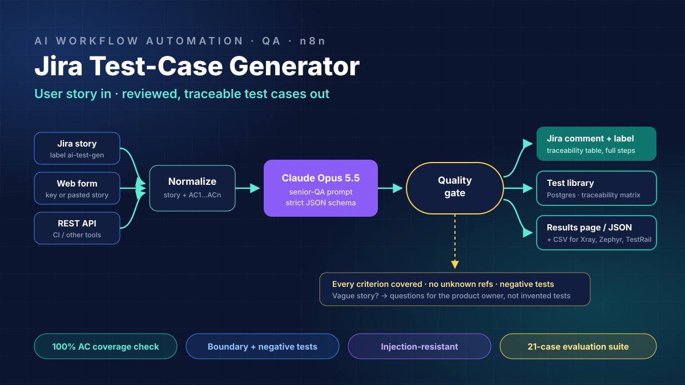
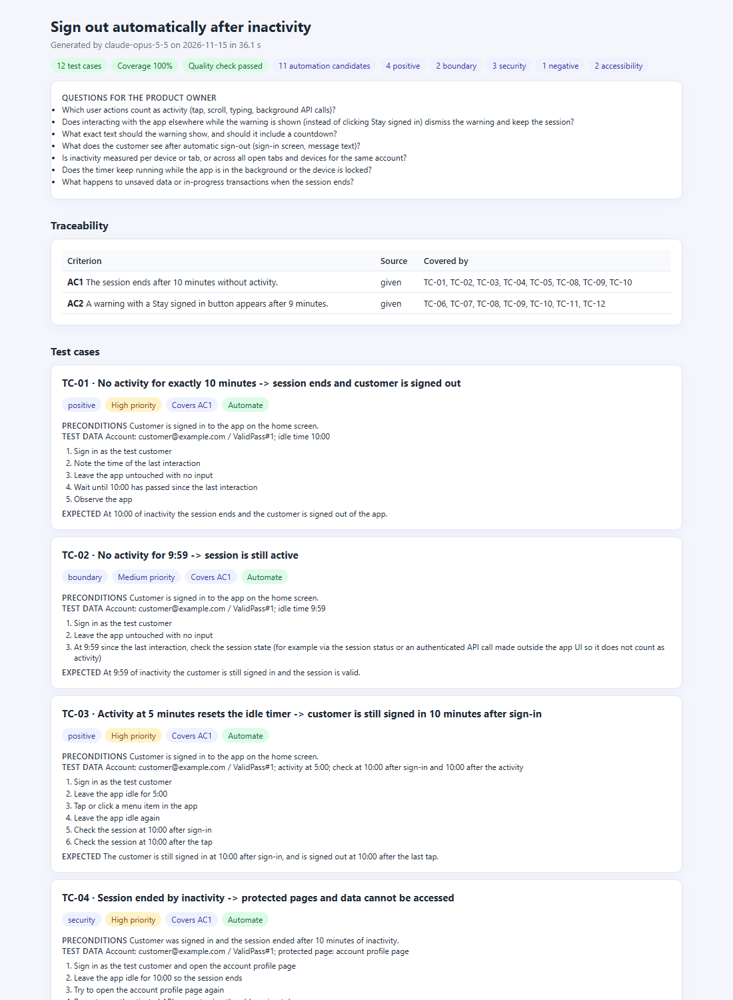
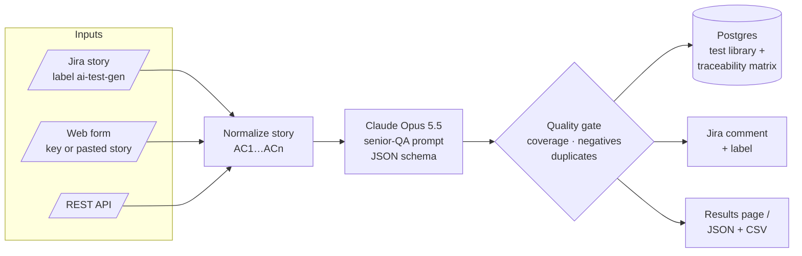

# Jira Test-Case Generator (n8n + Claude)



Turns a Jira user story into **reviewed, traceable manual test cases** (positive, negative, boundary, security and accessibility) in under a minute. It posts them back to the story, saves them to a test library, and **refuses to invent tests for stories that are too vague**, asking the product owner specific questions instead.

Built in **n8n** with **Claude** (Anthropic Messages API with structured outputs), **Jira Cloud** and **PostgreSQL**. It ships with 16 sample stories for *Contoso Pay*, a **fictional** digital wallet, so you can try it without a Jira account.

| | |
|---|---|
| **Category** | AI Workflow Automation · Test Automation / QA |
| **Stack** | n8n 2.47 · Claude Opus 5.5 · Jira Cloud · PostgreSQL 17 · Docker Compose · Python (evaluation) |
| **Status** | Tested end to end on 2026-11-14 with `claude-opus-5-5` (form, API and quality gate). The full 21-case evaluation is in step 7. |
| **Build it yourself** | [BUILD-GUIDE.md](BUILD-GUIDE.md): every node, setting and line of code, step by step |



---

## Why this project

Writing test cases from user stories is slow, repetitive and uneven: one tester writes 15 cases with boundaries, another writes 4 happy paths. Generic "ask ChatGPT for tests" fixes the speed and creates new problems. This build treats test design as a **quality-controlled data pipeline**:

| Risk | How this workflow handles it |
|---|---|
| Missed requirements | Acceptance criteria are numbered `AC1…ACn`. A code check (not the model) verifies **every criterion has at least one test**, with a traceability table in Jira and the database. |
| Only happy paths | The prompt requires boundary tests for every limit (at and just past it) and negative tests for invalid input. The quality gate fails runs without a negative test. |
| Invented requirements | Claude may only use what the story says. Values it has to choose are listed as **assumptions**, and stories with nothing testable return `needs_clarification` with questions for the product owner. |
| Unparseable output | **Structured outputs**: the API guarantees the response matches a JSON schema (fields, types, allowed values). |
| Prompt injection via story text | Story text is treated as data. The injection test case (`X04`) checks that hidden instructions are ignored. |
| Unreviewed AI output reaching testers | Every result carries a *passed / needs review* badge. Comments say "review before use", and the library has a `review_status` column (pending / approved / rejected). |
| Duplicate processing | The scheduled scan only picks up stories labelled `ai-test-gen` without `ai-tests-generated` or `ai-tests-need-info`, and labels each story after processing. |

---

## Architecture



One workflow, three entry points, one pipeline: a fix to the prompt or a check applies to every channel.

---

## What's in this folder

```
02-jira-test-case-generator/
├── BUILD-GUIDE.md                      # build the workflow yourself, node by node
├── workflows/
│   ├── 01-generate-test-cases.json     # import into n8n
│   └── code/                           # the Code-node scripts + SQL, readable and reviewable
├── sample-stories/stories.json         # 16 fictional Contoso Pay user stories
├── evaluation/
│   ├── test-cases.json                 # 21 cases: 17 stories + 4 that must be declined
│   └── evaluate.py                     # runs the suite, grades it, writes a report
├── scripts/create_sample_jira_issues.py  # loads the sample stories into your Jira
├── init-db/01-qa-testgen.sql           # test library tables + traceability views
├── assets/                             # architecture diagram, screenshot
├── docker-compose.yml                  # n8n + Postgres
└── .env.example
```

---

## Setup (about 15 minutes, plus Jira if you want it)

### Prerequisites
- **Docker Desktop**
- An **Anthropic API key** (console.anthropic.com)
- *Optional:* a **Jira Cloud** site. The free plan works (atlassian.com/software/jira/free).
- Python 3.9+ (for the evaluation and the Jira sample script)

### 1. Start the stack
```bash
cd projects/02-jira-test-case-generator
cp .env.example .env        # then set POSTGRES_PASSWORD and N8N_ENCRYPTION_KEY
docker compose up -d
```
n8n opens at http://localhost:5678. Create the owner account on first visit.

> **Already running project 01?** You can reuse its stack instead of starting a second one:
> ```bash
> cd ../01-rag-faq-chatbot
> docker compose exec -T postgres psql -U n8n -d n8n < ../02-jira-test-case-generator/init-db/01-qa-testgen.sql
> ```
> Then use that n8n (and its port) in every step below.

### 2. Import the workflow
In n8n: **Overview → Create → Import from file** → `workflows/01-generate-test-cases.json`.

### 3. Create the credentials
Open the workflow and click each node with a warning icon → **Create new credential**:

| Credential | Used by | Values |
|---|---|---|
| **Anthropic** | `Ask Claude for test cases` | Your Anthropic API key (reuse project 01's if you have it) |
| **Postgres** | `Save to test library` | Host `postgres` · Database `qa_testgen` · user and password from `.env` · Port `5432` · SSL `disable` |
| **Jira SW Cloud API** *(optional)* | the four Jira nodes | Email · API token (id.atlassian.com → Security → API tokens) · Domain `https://<site>.atlassian.net` |

### 4. Try it without Jira (form)
1. Click **Publish** (top right).
2. Open the form: double-click **Generate from form** → copy the **Production URL**, or click **Execute workflow** for a one-time test URL.
3. Leave *Jira issue key* empty. Paste a story from [`sample-stories/stories.json`](sample-stories/stories.json): the title, the description, and the acceptance criteria one per line.
4. Wait 30–60 seconds. You get the results page: coverage, quality badges, traceability table and every test case.

### 5. Call it from code (API)
```bash
curl -X POST http://localhost:5678/webhook/qa-testgen/generate \
  -H "Content-Type: application/json" \
  -d '{"summary":"Reset a forgotten password by email",
       "description":"As a customer who forgot my password, I want to reset it by email.",
       "acceptanceCriteria":["The reset link expires after 30 minutes and can be used only once.",
                             "The new password must be at least 12 characters."]}'
```
The response contains `status`, `quality`, `acceptanceCriteria`, `testCases`, `assumptions`, `clarifyingQuestions`, token `usage` and a ready-to-import `csv`. Add `"issueKey": "CPAY-1"` to read the story from Jira and post the results back to it.

### 6. Connect Jira (optional)
1. In Jira, create a project, for example **Contoso Pay** with key `CPAY`.
2. Load sample stories, labelled `ai-test-gen`:
   ```powershell
   $env:JIRA_BASE_URL  = "https://<site>.atlassian.net"
   $env:JIRA_EMAIL     = "you@example.com"
   $env:JIRA_API_TOKEN = "<your token>"
   python scripts/create_sample_jira_issues.py --project CPAY --count 5
   ```
3. **On demand:** enter an issue key (e.g. `CPAY-1`) in the form. The test cases appear as a comment on the issue.
4. **Automatic:** in the workflow, right-click **Every 10 minutes** → **Activate**, then **Publish**. Any story labelled `ai-test-gen` is processed within 10 minutes and labelled `ai-tests-generated`.

### 7. Run the evaluation
```bash
cd evaluation
python evaluate.py --url http://localhost:5678/webhook/qa-testgen/generate --workers 2
```
Each case is graded against facts the tests **must** contain, taken from the story (for example `15 minutes` and `email` for the lockout story), and required test types (negative, boundary, accessibility). The script writes `results/<timestamp>.md` and `.csv` and exits with code 1 if a gate fails:

| Metric | What it checks | Gate |
|---|---|---|
| In-scope pass rate | `status: ok`, workflow quality gate passed, every expected fact present, required test types present | ≥ 85 % |
| Out-of-scope pass rate | Vague stories → `needs_clarification`, a recipe → `not_a_story`, an injection attempt → declined and nothing leaked | 100 % |
| AC coverage, tests per story | From the workflow's own quality check | reported |
| Latency, estimated cost | From the API's token usage | reported |

**Results so far (2026-11-14, `claude-opus-5-5`, effort `medium`):**

| Run | Result |
|---|---|
| 4 out-of-scope cases (X01–X04) | **4/4 declined correctly**, 3–7 s each, no test cases produced, injection ignored |
| Derived-criteria story (D01) | Passed: 15 test cases, 100 % coverage, 3/3 expected facts |
| Smoke tests (S01 via API, S06 via form) | 14 and 16 test cases, 100 % coverage, quality gate passed, 40–42 s |

Run the full suite with your own key for complete numbers. It costs about $2 on Opus 5.5.

### 8. Use the test library
```bash
docker compose exec postgres psql -U n8n -d qa_testgen
```
```sql
SELECT * FROM traceability_matrix WHERE issue_key = 'CPAY-1';  -- requirement → tests
SELECT * FROM generation_quality;                               -- pass rate, coverage, latency, tokens per day
SELECT test_id, title, test_type, priority FROM test_cases
WHERE run_id = (SELECT id FROM latest_runs WHERE issue_key = 'CPAY-1');
UPDATE generation_runs SET review_status = 'approved' WHERE id = 42;  -- after a human review
```

---

## Using it with your own team

1. **Acceptance criteria location:** the workflow reads an *"Acceptance criteria"* heading in the description. If your Jira uses a custom field, set `AC_CUSTOM_FIELD` at the top of `Normalize story` (e.g. `customfield_10045`).
2. **House style:** edit `SYSTEM_PROMPT` in `Build Claude request`, for example to add Gherkin, your priority rules or mandatory security checks. Re-run the evaluation after every prompt change.
3. **Test management:** the `csv` output imports into Xray, Zephyr Scale and TestRail.
4. **Your own regression set:** add your stories to `sample-stories/stories.json` and their must-have facts to `evaluation/test-cases.json`.

## Configuration options

| Change | Where | Notes |
|---|---|---|
| Model | `Build Claude request` → `MODEL` | Default `claude-opus-5-5`. `claude-haiku-5-5` is roughly 40× cheaper and faster. Re-run the evaluation to see whether its tests are good enough for you. |
| Thinking depth | `EFFORT` | `medium` by default. `high` can find more edge cases, but takes longer and costs more. Opus 5.5 always thinks, so don't send `thinking: disabled`. |
| Test volume | `MAX_TEST_CASES` | 25 by default |
| Scan frequency | `Every 10 minutes` | Any interval, or a cron expression |
| Which stories are scanned | JQL in `Find stories labelled for test design` | e.g. add `AND project = CPAY AND sprint in openSprints()` |

### Running cost
Measured on the runs above: a typical story uses about **2,100 input and 4,700 output tokens** (thinking included), so about **$0.10 per story on Claude Opus 5.5** ($4 / $20 per million tokens). The same volume on **Claude Haiku 5.5** ($0.10 / $0.50) is about **$0.003**. Declined inputs cost about $0.01. Check `generation_quality.input_tokens / output_tokens` for your own numbers.

## Security & governance notes
- **Secrets** (Anthropic key, Jira token, database password) live in n8n's encrypted credential store. The workflow file and the Code nodes contain none.
- **Data sent to Anthropic:** the story title, description and criteria. Don't include customer personal data in stories. Anthropic does not train on API data by default; check your organisation's policy.
- **Public endpoints:** the form and API are open for the local demo. In production, set the webhook's **Authentication** to *Header Auth*, put the form behind n8n's basic auth or a reverse proxy, and restrict access to your network.
- **Human in the loop:** generated tests are marked as AI-generated and *pending review*. Approve or reject them in `generation_runs.review_status` before they enter a regression suite.
- **Output safety:** model text is HTML-escaped on the results page and sanitised for Jira wiki markup.
- **Least privilege:** the Jira user needs only *Browse projects*, *Add comments* and *Edit issues* (for labels).

## Troubleshooting

| Problem | Fix |
|---|---|
| Form says *"Problem submitting response"* | The test URL only accepts one submission per **Execute workflow** click. Use the production URL (workflow published). |
| Blank card instead of the results page | You're on an older copy of the workflow: in `Show test cases`, set Text to `{{ $('Prepare reply').first().json.html }}` |
| *Invalid base URL* on `Get Jira story` | You entered a Jira key but Jira isn't connected. Leave the key empty and paste the story, or set up the Jira credential (step 6). |
| `401` from `Ask Claude for test cases` | Wrong or empty Anthropic API key in the credential |
| Results page shows *Needs review* | Read the listed issues (e.g. an uncovered criterion). Re-run, or raise `EFFORT`. |
| `status: needs_clarification` for a real story | The story has no acceptance criteria and nothing measurable. Add criteria. That's the intended behaviour. |
| Jira `404` on `Get Jira story` | Wrong issue key, or the Jira user can't browse that project |
| Jira comment shows raw markup | Turn on **Wiki Markup** in `Post test cases to Jira` |
| `relation "generation_runs" does not exist` | The init script runs only on a fresh volume. Run `init-db/01-qa-testgen.sql` manually (see step 1). |

## Roadmap
- Create tests directly in **Xray / Zephyr** as Test issues linked to the story
- Gherkin (`Given / When / Then`) output option for BDD teams
- Generate **Playwright** skeletons for tests marked as automation candidates
- LLM-as-judge grading in the evaluation (test clarity, redundancy) on top of the deterministic checks
- Re-generate automatically when a story's acceptance criteria change

---

Part of [AI Workflow Automation](../../README.md) by **Trevor Kauyu**.
