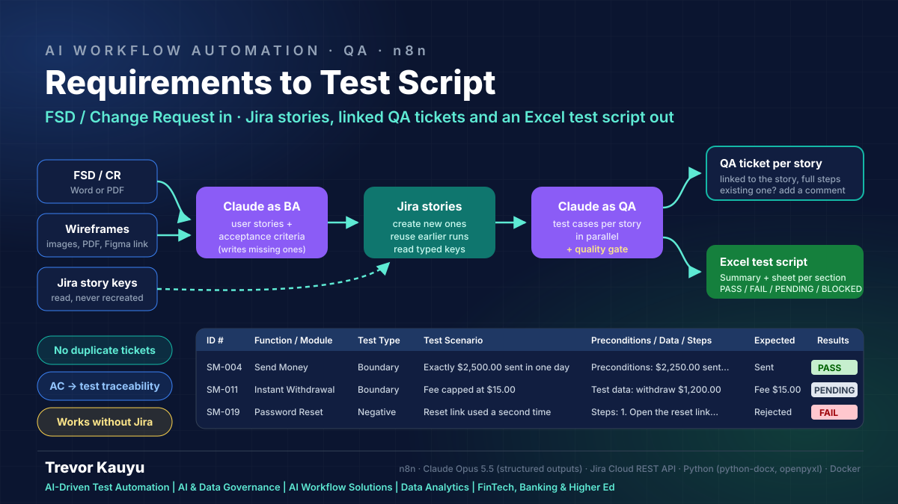
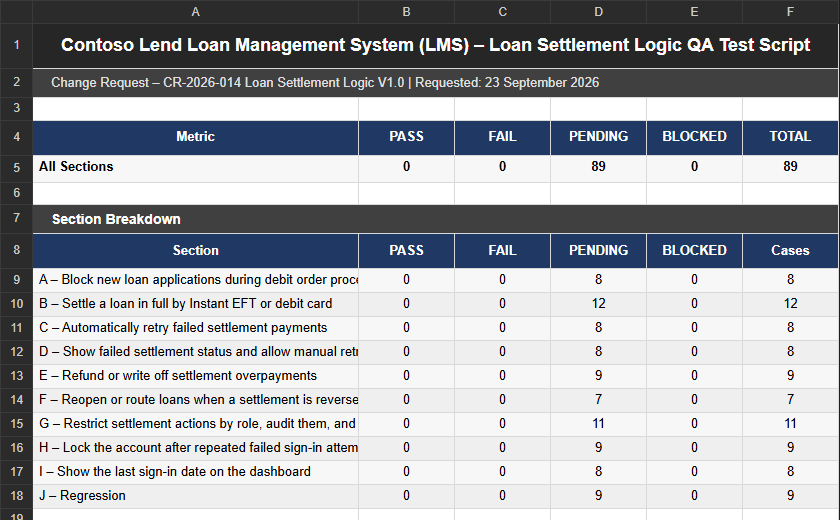
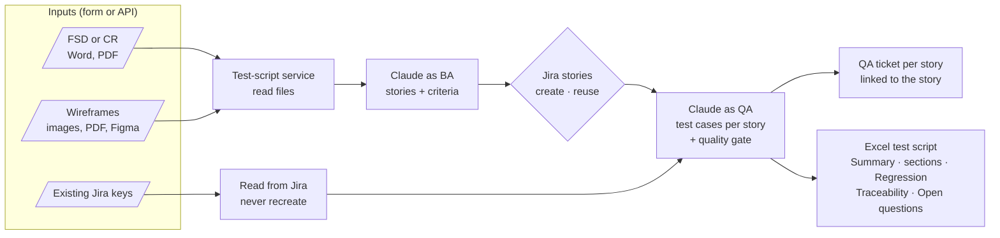
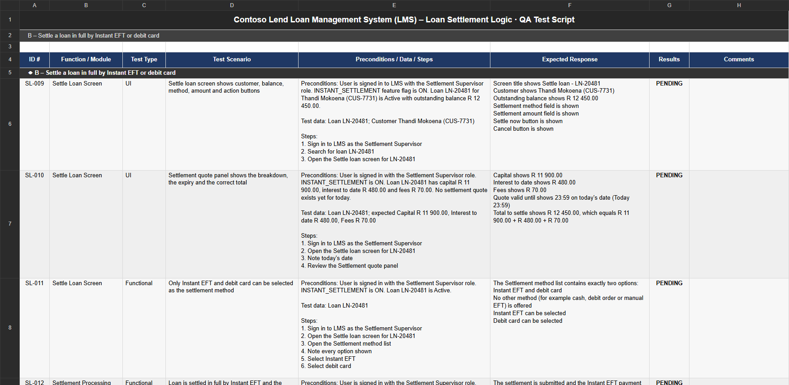

# Requirements to Test Script (n8n + Claude + Jira)



Upload a **Functional Specification (FSD) or Change Request** in Word or PDF, add **wireframes** (images, PDF or a Figma link), or type **existing Jira story keys**. The workflow:

1. breaks the document into **user stories with acceptance criteria**. Criteria the document doesn't state are **written for you** and marked *generated*;
2. **creates the stories in Jira**, with the user story, description, source references and criteria. Existing stories are read and **never recreated**;
3. writes **detailed test cases** for every story, checked by a quality gate;
4. creates a **QA ticket per story in Jira, linked to its story**;
5. gives you an **Excel test script** in a bank-style format: a Summary sheet with PASS / FAIL / PENDING / BLOCKED counts, one sheet per section, and a Regression section.

Built in **n8n** with **Claude** (Anthropic Messages API, structured outputs), the **Jira Cloud REST API** and a small **Python service** for Word/PDF reading and Excel output. It ships with a sample Change Request for *Contoso Lend*, a **fictional** lender, and a **mock Jira**, so you can try everything without a Jira site.

| | |
|---|---|
| **Category** | AI Workflow Automation · Test Automation / QA · Business Analysis |
| **Stack** | n8n 2.47 · Claude Opus 5.5 · Jira Cloud REST API · Python (FastAPI, python-docx, openpyxl) · Docker Compose |
| **Status** | Tested end to end on 2026-11-14 with `claude-opus-5-5` and the mock Jira (see [Tested results](#tested-results)). The re-run duplicate check found a bug. It is fixed and covered by an offline test, but the fixed version has not yet been re-run live. |
| **Build it yourself** | [BUILD-GUIDE.md](BUILD-GUIDE.md): every node, setting and line of code, step by step |



---

## Why this project

Turning an FSD into test-ready work is mostly manual: a BA writes stories, someone types them into Jira, a tester writes the test script in Excel and links QA tickets by hand. It takes days per change request, and criteria get lost between documents. This workflow does the first draft of all of it in minutes, with controls a QA lead would ask for:

| Risk | How this workflow handles it |
|---|---|
| Requirements lost between FSD, Jira and the test script | One pipeline: every story keeps its **source references** (FR-02, BR-04.1, Figure 1). Every criterion is numbered and traced to test ids in the **Traceability** sheet. |
| Stories without acceptance criteria | Claude writes them from the requirement and marks them **generated**, in Jira and in the Excel. You can see which criteria came from the document. |
| Duplicate tickets | Stories created from a document get a label for that change request. A second run finds them, Claude matches the re-worded stories to them by scope (checked in code), and they are **reused**. Typed Jira keys are only read. A story that already has a linked QA ticket gets a **comment** instead of a second ticket. |
| Invented rules | Claude may only use what the documents and wireframes say. Missing or contradictory points become **Open Questions** for the BA instead of guesses. |
| Happy-path-only testing | Boundary tests at and just past every limit, negative tests with exact messages, permission, audit, integration and regression tests. A **quality gate** in code (not the model) checks coverage, references and negative tests for every story. |
| Unparseable AI output | **Structured outputs**: the API guarantees the JSON matches the schema. |
| One failing Jira call breaking the run | Jira errors are recorded per story in the Excel and the completion message. The test script is still produced. |
| Prompt injection through documents | Documents are treated as data to analyse, never as instructions. |

---

## Architecture



| Part | What it does |
|---|---|
| **n8n workflow** (38 nodes + 4 notes) | Form + API, orchestration, Jira calls, quality gate, completion page |
| **Test-script service** (`service/`) | Reads `.docx` (headings, tables, embedded pictures), passes PDFs and images to Claude, exports Figma frames, and writes the formatted `.xlsx`. No keys, no published port. |
| **Claude Opus 5.5** | The whole document as a business analyst; on a re-run, a quick match against earlier stories; then one call per story as a QA engineer, in parallel. |
| **Jira Cloud REST API** | Create stories, read stories, find earlier runs, create QA tickets, link them, comment |
| **Mock Jira** (`scripts/mock_jira.py`) | Optional stand-in for demos and tests |

---

## The Excel test script

| Sheet | Contents |
|---|---|
| **Summary** | Title, change request and requested date. PASS / FAIL / PENDING / BLOCKED / TOTAL for all sections and per section. Pass rate and execution progress. **All counts are formulas**, so they update as testers record results. |
| **A – …, B – …** | One sheet per story: `ID # · Function / Module · Test Type · Test Scenario · Preconditions / Data / Steps · Expected Response · Results · Comments`, then `Priority · Covers · Jira Story · QA Ticket` (linked). **Results** is a drop-down (PENDING, PASS, FAIL, BLOCKED) with colours. Header row frozen, filters on, prints landscape. |
| **Regression** | Existing behaviour next to the change that must keep working, from every story |
| **Stories & Tickets** | Each story with its Jira story, QA ticket, origin (created / reused / existing / preview), criteria, generated criteria, tests, coverage and quality gate |
| **Traceability** | Every acceptance criterion, its source (Document / Jira / Generated by AI) and the tests that cover it |
| **Open Questions** | Questions for the product owner or BA, with an Answer column |



---

## What's in this folder

```
03-requirements-to-test-script/
├── README.md                       this file
├── BUILD-GUIDE.md                  build the workflow yourself, node by node
├── docker-compose.yml              n8n + test-script service (+ mock Jira with --profile demo)
├── .env.example                    settings to copy into .env
├── workflows/
│   ├── 01-requirements-to-test-script.json   the n8n workflow (import this)
│   └── code/                       the 14 Code-node scripts, readable on their own
├── service/                        the Python test-script service + unit tests
├── sample-input/                   sample Change Request (.docx) and two wireframes
├── sample-output/                  the Excel test script produced from the sample
├── scripts/
│   ├── run_pipeline.py             call the API from the command line
│   ├── mock_jira.py                mock Jira Cloud for demos
│   └── make_sample_documents.py    rebuilds sample-input/
└── assets/                         diagram and screenshots
```

---

## Setup (about 15 minutes)

### Prerequisites
- **Docker Desktop**
- An **Anthropic API key** (console.anthropic.com)
- *Optional:* a **Jira Cloud** site (the free plan works), or the bundled mock Jira
- *Optional:* a **Figma** personal access token, only for Figma links
- Python 3.9+ for the command-line scripts

### 1. Start the stack
```bash
cd projects/03-requirements-to-test-script
cp .env.example .env            # set N8N_ENCRYPTION_KEY (and FIGMA_TOKEN if you use Figma links)
docker compose --profile demo up -d --build      # without "--profile demo" if you use a real Jira
```
n8n opens at http://localhost:5678. Create the owner account on first visit.

### 2. Import the workflow and fill in Settings
1. **Overview → Create → Import from file** → `workflows/01-requirements-to-test-script.json`.
2. Open the **Settings** node:

| Field | Value |
|---|---|
| `jiraBaseUrl` | `https://<your-site>.atlassian.net`, or `http://mock-jira:8089` for the mock |
| `jiraProjectKey` | Default project for new stories, e.g. `CPAY` (the form can override it) |
| `storyIssueType` | `Story` |
| `qaIssueType` | `Task` (or `Sub-task` to put QA tickets under the story, or `Test` with Xray) |
| `qaLinkType` | `Relates` (or `Test` with Xray) |
| `defaultTestIdPrefix` | Used when the document doesn't suggest one, e.g. `TC` |
| `model` | `claude-opus-5-5` |
| `serviceUrl` | `http://testscript-service:8000` (leave as is) |

### 3. Create the credentials
| Credential | Used by | Values |
|---|---|---|
| **Anthropic** | `Analyse requirements`, `Write test cases` | Your Anthropic API key |
| **Jira SW Cloud API** | the six Jira nodes | Email · API token (id.atlassian.com → Security → API tokens) · Domain = your site. For the mock: any e-mail and token, domain `http://mock-jira:8089`. |

### 4. Run it from the form
1. Click **Publish**, then open **Upload requirements** → copy the **Production URL**.
2. Upload `sample-input/CR-2026-014 Loan Settlement Logic V1.0.docx` under *Requirements documents*, and the two PNGs under *Wireframes*.
3. Choose **No** for *Create Jira tickets* to try it without Jira, or **Yes** and project `CPAY`.
4. Wait 2–3 minutes. The page shows a summary and the Excel test script downloads. A copy is saved in `output/`.

To build from existing stories instead, type keys such as `CPAY-1, CPAY-2` in *Existing Jira stories* (the mock Jira has these two). They are read and get QA tickets and test cases. They are never recreated.

### 5. Run it from the command line (API)
```bash
python scripts/run_pipeline.py \
  --document "sample-input/CR-2026-014 Loan Settlement Logic V1.0.docx" \
  --wireframe sample-input/wireframe-settle-loan.png \
  --wireframe sample-input/wireframe-settlement-failed.png \
  --create-jira --project CPAY
```
The API (`POST /webhook/req2test/run`) takes JSON with base64 files and returns the `.xlsx`:
```json
{ "documents": [{ "name": "fsd.pdf", "data": "<base64>" }], "wireframes": [], "figmaUrl": "",
  "jiraStories": "CPAY-1, CPAY-2", "jiraProjectKey": "CPAY", "createJiraTickets": true,
  "systemName": "", "testIdPrefix": "" }
```

### 6. Look at the tickets
- **Mock Jira:** open http://localhost:8089/browse/CPAY-3 (stories, links and comments), or http://localhost:8089/_state for everything.
- **Real Jira:** the new stories carry the labels `ai-generated-story` and `req2test-<change-request>`. QA tickets are labelled `ai-qa-tests`, titled `QA: <story>`, and linked to their story.

---

## Tested results

Sample input: the Contoso Lend Change Request (5 functional requirements, 1 business-rule table, 1 embedded wireframe) plus the two wireframe images. All runs used the API on n8n 2.47.7.

| Run | Mode | Result |
|---|---|---|
| 1 | Preview (no Jira) | 13 stories, 177 tests, 104 open questions, **$2.19**, 183 s. Correct, but far more granular than a real test script, so the prompts were tuned (one story per requirement, 6–12 tests each, at most 10 document-level questions). |
| 2 | Jira (mock) + existing stories `CPAY-1, CPAY-2` | **7 stories created** (`CPAY-3…9`, labelled with the CR), **2 existing stories read, not recreated**, **9 QA tickets created and linked** (`CPAY-10…18`). 89 tests in 9 sections + Regression, ids `SL-001…SL-089`. Quality gate passed for 9 of 9 stories, 100% criteria coverage. **$1.36**, 147 s. This is the file in [`sample-output/`](sample-output/). |
| 3 | Same input again | QA tickets of matched stories got **comments, not copies**, and `CPAY-1`/`CPAY-2` were again only read. **But 4 of 7 stories were created a second time**: Claude had worded their titles differently, and the first version matched by exact title. |
| Fix | Offline test with run 3's real data | Added `Match earlier stories`: Claude matches stories by scope, and the code accepts only real, unused keys. Replaying run 3's analysis through the new `Plan stories`: titles only gives 4 duplicates (the bug reproduced); with matching, **7 reused, 0 created**; an invalid matcher answer is rejected safely. |

What the run-2 workbook shows:
- Criteria are marked by source: for FR-01 they are copied from the document; FR-02 to FR-05 had none, so all of theirs are **Generated by AI**. They are flagged the same way in the Jira stories.
- Wireframe details appear in the tests (screen title *Settle loan - LN-20481*, *R 12 450.00*, *Failed - code 51*).
- Boundary tests sit at the document's limits: R10.00 vs R10.01 overpayment, day 40 vs day 41 reversal, the 3rd retry, 23:59 quote expiry.
- The permissions, audit and feature-flag rules became one combined story, as in a typical bank test script.

---

## Using it with your own team

1. **Your template:** column names, colours and sheet layout are in `service/excel_builder.py` (`SECTION_COLUMNS`, the fills at the top). Rebuild with `docker compose up -d --build`.
2. **House style for tests:** edit `SYSTEM_PROMPT` in `Build test request`, for example to add Gherkin, mandatory security checks or your priority rules.
3. **How stories are split:** edit `SYSTEM_PROMPT` in `Build analysis request` (story size, roles, `MAX_STORIES`).
4. **Acceptance criteria in a Jira custom field:** set `AC_CUSTOM_FIELD` in `Read Jira story`.
5. **Xray / Zephyr:** set `qaIssueType` to `Test` and `qaLinkType` to `Test` (check the link direction in your Jira).

## Configuration options

| Change | Where | Notes |
|---|---|---|
| Model | Settings → `model` | `claude-opus-5-5` by default. Remember to update `PRICE_PER_MTOK` in `Collect results` if you switch. |
| Analysis depth | `Build analysis request` → `EFFORT` | `high`: splitting a whole document deserves careful thought |
| Test depth | `Build test request` → `EFFORT`, `MAX_TEST_CASES` | `medium`, 20 per story |
| Parallel Claude calls | `Write test cases` → Options → Batching | 4 at a time |
| Images per run | `Read files` body → `maxImages` | 20; each image costs about 1,500 input tokens |

### Running cost
Measured: **about $1.36** for the sample CR with two extra Jira stories: 9 stories, about 35,000 input and 61,000 output tokens on Claude Opus 5.5 ($4 / $20 per million). Most of it is output (thinking plus test cases), so cost grows with the number of stories, not the length of the document. The Summary sheet prints each run's token use and estimated cost. A re-run adds one small matching call (a few cents). `claude-haiku-5-5` ($0.10 / $0.50) would cost roughly 40× less, but its test quality on this task is untested.

## Security & governance notes
- **Secrets** (Anthropic key, Jira token) live in n8n's encrypted credential store. The Figma token stays in `.env` and is used only by the service. The workflow and code contain none.
- **Data sent to Anthropic:** the uploaded documents and wireframes. Remove customer personal data from FSDs first. Anthropic does not train on API data by default; check your organisation's policy.
- **The service** has no published port and only n8n can reach it. It stores each Excel in `output/`.
- **Public endpoints:** the form and API are open for the local demo. In production, add authentication to the webhook and form, or keep n8n on your internal network.
- **Human in the loop:** stories are created in *To Do*, AI-written criteria are marked *(generated)*, and every story shows a quality gate result. Review before sprint planning.
- **Least privilege:** the Jira user needs *Browse projects*, *Create issues*, *Link issues* and *Add comments* in the target projects.

## Troubleshooting

| Problem | Fix |
|---|---|
| *Jira is not set up yet* | Set `jiraBaseUrl` in **Settings**, or choose **No** for *Create Jira tickets* |
| *old .doc format* warning | Save the document as `.docx` or PDF |
| Form shows *Problem submitting response* | Use the production URL (workflow published). The test URL takes one submission per **Execute workflow** click. |
| Stories show *Not created in Jira (error)* | Read the note in *Stories & Tickets*. Usually the issue type doesn't exist in that project (`storyIssueType`) or the user can't create issues there. |
| QA ticket created but *not linked* | The link type name in `qaLinkType` doesn't exist in your Jira. `Relates` exists by default. |
| `400` from `Analyse requirements` | The document is too large or a PDF is encrypted. Split it, or export without a password. |
| `ECONNREFUSED testscript-service` | The service container isn't running: `docker compose up -d --build` |
| A run takes longer than expected | Big documents take longer in the analysis step. Lower `EFFORT` to `medium`, or split the document. |

## Roadmap
- Attach the Excel to each QA ticket
- Write AI-generated acceptance criteria back to existing Jira stories (after review)
- Create Xray / Zephyr test steps directly
- Update the Excel's Results from Jira status, and back
- Confluence pages as an input

---

Part of [AI Workflow Automation](../../README.md) by **Trevor Kauyu**.
