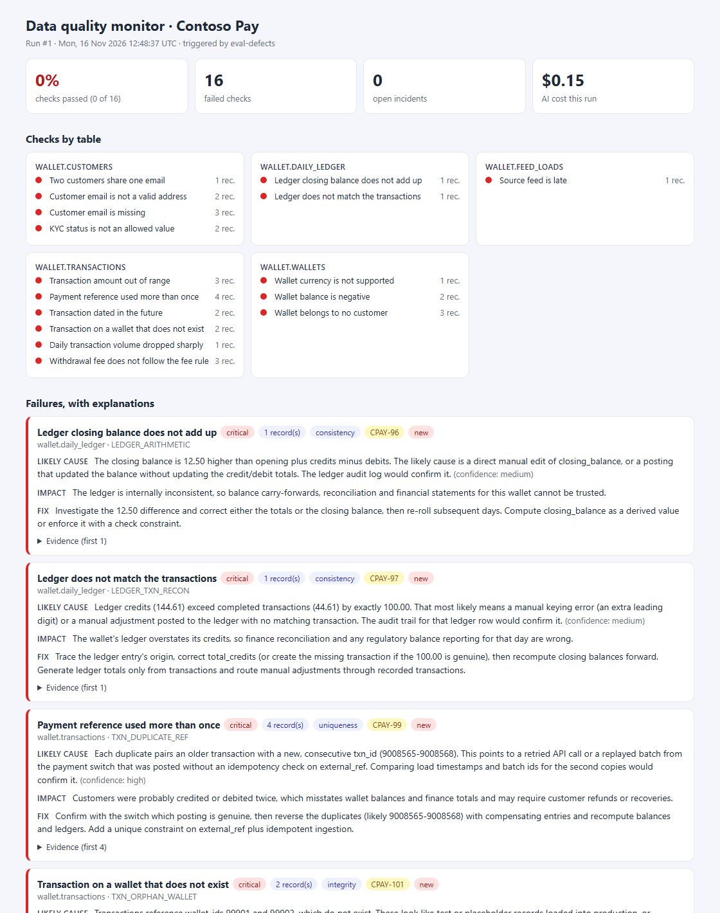
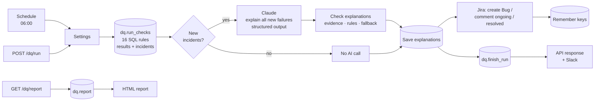
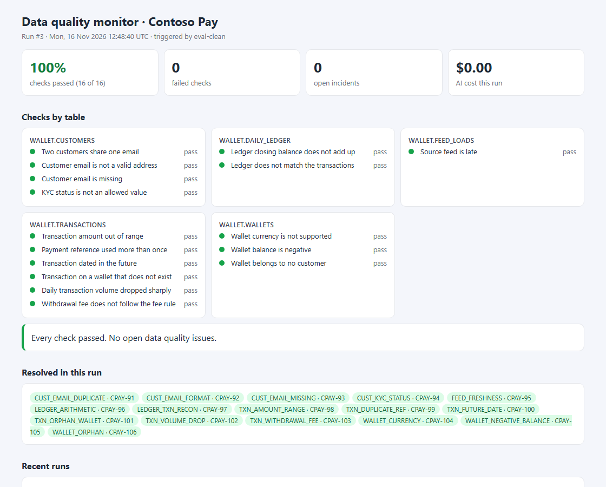

# AI Data Quality Monitor (n8n + Claude + PostgreSQL)

Runs **SQL data quality rules** against a mobile money database on a schedule, opens and resolves **incidents**, and asks **Claude** to explain each new failure (likely cause, business impact, fix) for the data owner. **Code checks every explanation** before it reaches **Jira**.

The design rule: **SQL decides what failed. The model only explains why.**

| | |
|---|---|
| **Category** | AI Workflow Automation · Data Quality · Data Governance |
| **Stack** | n8n 2.47 · PostgreSQL 17 (rules, functions, results) · Claude Opus 5.5 (structured outputs) · Jira Cloud REST API · Python (data generator, evaluation) · Metabase (optional) · Docker Compose |
| **Status** | Tested end to end on 2026-11-16 with `claude-opus-5-5` and the mock Jira: **10 of 10 quality gates passed**, 16 of 16 planted defects caught with the exact record ids, 0 false alarms, **$0.15** per explaining run (see [Tested results](#tested-results)) |
| **Build it yourself** | [BUILD-GUIDE.md](BUILD-GUIDE.md): the database, every node, and the evaluation, step by step |



---

## Why this project

Data problems in a payments business are expensive and quiet: a payment posted twice, a fee engine missing its cap, a ledger out by 12.50, a settlement feed that stopped two days ago. Most teams find them late, in a reconciliation or a customer complaint. Rule-based monitors catch them early but produce alerts nobody reads ("TXN_DUPLICATE_REF failed: 4 rows"), and pure "AI anomaly detection" can't be audited.

This workflow combines the two, with controls a data governance lead would ask for:

| Risk | How the workflow handles it |
|---|---|
| An AI decides something is broken when it isn't (or misses it) | **Detection is pure SQL.** Each rule returns its failing rows. Claude never decides pass or fail. Results are stored per run for audit |
| Explanations invent records or link unrelated problems | **"Check explanations"** accepts only ids Claude was shown and links to rules that actually failed. Anything else is replaced with a plain fallback note and logged |
| Alert fatigue and duplicate tickets | **One open incident per rule.** A repeat failure adds a Jira comment; a fixed one is resolved automatically with a comment |
| Paying the model to repeat itself | Only **new** incidents are sent to Claude. A run with no new failures makes **no AI call** and costs $0 |
| Customer data sent to an AI service | Rule details carry ids, not names. **Emails are masked** before sending, keeping their shape so a format fault stays visible |
| Rules hidden in code that nobody can review | **Rules are rows** in `dq.rules` (SQL, owner, severity, dimension). Add or change one without touching the workflow |
| A monitor that can't be trusted | An **evaluation suite** plants 16 known defects and grades detection, false alarms, explanations, ticketing and the incident lifecycle |

## Architecture



| Part | Role |
|---|---|
| **PostgreSQL** (`contoso_dq`) | `wallet.*` holds the monitored data (customers, wallets, transactions, daily ledger, feed loads). `dq.*` holds the monitor: rules, runs, results, incidents, and the functions n8n calls |
| **`dq.run_checks()`** | Runs every active rule, stores the count, 5 sample rows and up to 1,000 failing record ids, then opens, updates or resolves incidents. Deterministic and testable without n8n |
| **n8n workflow** (24 nodes + 3 notes) | Schedule + API + report page, the Claude call, the explanation check, Jira, Slack and the API response |
| **Claude Opus 5.5** | One call per run, only for new incidents, so it can spot failures with a shared cause |
| **Jira Cloud REST API** | A Bug per new incident with the explanation, the evidence and the SQL to reproduce it; comments on ongoing and resolved incidents |
| **Metabase** (optional) | Dashboards on the `dq.v_run_history`, `dq.v_latest_results` and `dq.v_open_incidents` views |

## The rules

16 rules across 7 data quality dimensions, on a fictional mobile wallet, **Contoso Pay**:

| Dimension | Rule | Catches |
|---|---|---|
| Completeness | `CUST_EMAIL_MISSING` | Customers with no email (NULL, empty or spaces) |
| Validity | `CUST_EMAIL_FORMAT` · `CUST_KYC_STATUS` · `WALLET_NEGATIVE_BALANCE` · `WALLET_CURRENCY` · `TXN_AMOUNT_RANGE` · `TXN_FUTURE_DATE` | Bad emails, unknown KYC values, balances below zero, non-ISO currencies, amounts ≤ 0 or > 10,000, future timestamps |
| Uniqueness | `CUST_EMAIL_DUPLICATE` · `TXN_DUPLICATE_REF` | Two customers on one email (any case); a payment reference posted twice |
| Integrity | `WALLET_ORPHAN` · `TXN_ORPHAN_WALLET` | Wallets without a customer; transactions without a wallet |
| Consistency | `TXN_WITHDRAWAL_FEE` · `LEDGER_ARITHMETIC` · `LEDGER_TXN_RECON` | The fee rule from [project 03's FSD](../03-requirements-to-test-script/) (1.5%, min 0.25, max 15.00); closing ≠ opening + credits − debits; ledger ≠ transactions |
| Timeliness | `FEED_FRESHNESS` | A source feed that missed its load SLA |
| Volume | `TXN_VOLUME_DROP` | Yesterday's transactions below half the previous 7-day average (an empty day counts as 0) |

Each rule is one row: a SQL query that returns one row per violation (record id + detail), plus its owner, severity and description. See [`init-db/02-rules.sql`](init-db/02-rules.sql).

## What's in this folder

```
04-data-quality-monitor/
├── README.md · BUILD-GUIDE.md
├── docker-compose.yml · .env.example
├── init-db/
│   ├── 00-create-database.sql        contoso_dq, UTC
│   ├── 01-schema.sql                 wallet.* and dq.* tables, the functions n8n calls, dashboard views
│   └── 02-rules.sql                  the 16 rules
├── workflows/
│   ├── 01-data-quality-monitor.json  import into n8n
│   └── code/                         every Code node as a readable .js file
├── scripts/
│   ├── generate_data.py              sample data + planted defects + the answer key
│   └── mock_jira.py                  in-memory Jira for demos
├── evaluation/
│   ├── evaluate.py                   end-to-end evaluation with quality gates (exit 1 on failure)
│   ├── rule-edge-cases.sql           boundary tests for the trickiest rules
│   ├── test-check-explanations.js    guardrail tests against a real Claude response
│   ├── fixture-live-run-4.json       that response (fictional data)
│   └── planted-defects.json          the answer key
└── assets/                           screenshots
```

---

## Setup (about 15 minutes)

### Prerequisites
- Docker Desktop
- An Anthropic API key
- Python 3.9+ (data generator and evaluation; standard library only) and, optionally, Node.js (guardrail tests)
- Jira Cloud, or the mock Jira included here

### 1. Start the stack
```bash
cp .env.example .env              # fill in the passwords and the encryption key
docker compose --profile demo up -d
```
The database, schema and rules are created on first start. Open n8n at http://localhost:5678.

### 2. Load the sample data
```bash
python scripts/generate_data.py               # data with 16 planted defects
docker exec -i dq-postgres psql -U <POSTGRES_USER> -d contoso_dq -q < data/seed.sql
```
Use `--clean` for data that passes every rule.

### 3. Import the workflow and fill in Settings
**Workflows → Import from file →** `workflows/01-data-quality-monitor.json`. Open **Settings**:

| Field | Value |
|---|---|
| `model` | `claude-opus-5-5` (or `claude-haiku-5-5` for a cheaper run) |
| `sampleRows` | Sample rows stored and sent per failed rule (default 5) |
| `jiraEnabled` · `jiraBaseUrl` · `jiraProjectKey` · `jiraIssueType` | Your Jira site, or `http://mock-jira:8089` and any key for the mock |
| `slackWebhookUrl` | Optional: a Slack incoming-webhook URL for the run summary |
| `reportUrl` | `http://localhost:5678/webhook/dq/report` |

### 4. Create the credentials
| Credential | Used by | Values |
|---|---|---|
| **Postgres** | the 5 Postgres nodes | Host `postgres`, database `contoso_dq`, your `POSTGRES_USER` / `POSTGRES_PASSWORD`, SSL disabled |
| **Anthropic** | `Explain failures` | Your API key |
| **Jira SW Cloud API** | `Update Jira` | Email, API token, domain. For the mock: any values, domain `http://mock-jira:8089` |

### 5. Run it
Activate the workflow. It runs every morning at 06:00, or now:
```bash
curl -X POST http://localhost:5678/webhook/dq/run -H "Content-Type: application/json" -d '{"trigger":"manual"}'
```
The response lists every failure with its explanation, Jira key and cost. Open the report at http://localhost:5678/webhook/dq/report (add `?run=N` for an earlier run), and the mock tickets at http://localhost:8089/_state.

### 6. Run the evaluation
```bash
python evaluation/evaluate.py --url http://localhost:5678/webhook/dq/run --pg-container dq-postgres --pg-user <POSTGRES_USER>
```
It reloads the data three times, so run it on a demo database only.

---

## Tested results

All runs on 2026-11-16, n8n 2.47.7, `claude-opus-5-5`, mock Jira.

### Final evaluation: 10 of 10 gates passed

| Gate | Result |
|---|---|
| Rule edge-case tests (SQL) | **6 / 6** |
| Guardrail tests (offline, real Claude response) | **10 / 10** |
| Detection: planted defects caught with exactly the right record ids | **16 / 16** |
| False alarms (unexpected failures + failures on clean data) | **0** |
| Explanations passing the code check | **16 / 16** |
| Likely cause names a plausible root cause (keyword check) | **16 / 16** |
| A Jira ticket per incident | **16 / 16** |
| Same data again: no new incidents, 16 ongoing, no AI call | **new 0 · ongoing 16 · $0.00** |
| Clean data: every incident resolved | **16 resolved · 0 failed** |
| Cost of the explaining run | **$0.15** (7,716 input / 6,064 output tokens, 57 s) |

The 16 checks themselves run in about 0.1 s in total; the time is the Claude call.

### What the explanations look like
Specific, quantified, and with a way to confirm the cause. For example:

- **Withdrawal fee:** *"The fee engine applies a flat 1.5% without the 0.25 minimum (10.00 was charged 0.15) or the 15.00 cap (2000.00 was charged 30.00). It also truncates instead of rounding (33.33 gave 0.49, not 0.50)."*
- **Duplicate payment references:** *"The four duplicates all have consecutive new txn_ids pointing back to originals from different days… a batch replay or retried switch messages, with no idempotency or unique constraint on external_ref."*
- **Run summary:** without being told, Claude noticed that most failing transactions sat in one consecutive id block, and suggested a single bad batch or test data loaded into production. That is how the defects were planted.

### What testing found and fixed
| Found | Fix | Proof |
|---|---|---|
| **Claude found a bug in a rule.** Explaining `TXN_VOLUME_DROP`, it noted that the rule used the latest date in the data, which in production is *today's partial day*: a false alarm every morning. The test data had no rows for today, so the evaluation couldn't see it. A second flaw: a day with zero transactions produced no row at all | The rule now compares **yesterday (UTC)** with the 7 days before, and counts an empty day as 0 | [`rule-edge-cases.sql`](evaluation/rule-edge-cases.sql): partial day ignored, empty day caught |
| **The guardrail was too strict.** In live run #4 it rejected 2 of 16 explanations because Claude cited real ids quoted in a row's detail text ("used by customers 1854, 2108") rather than the record id | The check now accepts any id Claude was shown, and still rejects anything else | [`test-check-explanations.js`](evaluation/test-check-explanations.js): replays that real response; the old check fails 2, the new one passes 16, and an invented id, a bad rule link, a refusal and an API error are still rejected |
| **A DNS failure** inside Docker (`EAI_AGAIN api.anthropic.com`) made one run's Claude call fail. The monitor still detected everything and opened tickets with fallback notes, as designed | n8n's retry (3 tries, 5 s apart) on the Claude and Jira calls | The next evaluation passed 10/10 |
| `dq.run_summary` only attached explanations from incidents that were *still open*, so past runs showed none | Joins the incident that was open during that run | The report's `?run=N` shows run #1 with all 16 explanations |



---

## Using it with your own data

1. **Point it at your database:** change the Postgres credential, keep the `dq` schema (run `init-db/01-schema.sql` there).
2. **Write your rules:** one row in `dq.rules` each. The query returns one row per violation, with two columns: the record id, then a detail text. Don't put names or other personal data in the detail.
3. **Describe your business** in the system prompt of `Plan explanations` (what the tables are and which systems feed them). Better context gives better causes.
4. **Calibrate severity and owners** in the rules table; ticket severity comes from the rule, not from the AI.
5. **Plant your own defects** in a copy of your data to measure the monitor before you trust it.

## Configuration options

| Where | What |
|---|---|
| `Settings` | Model, sample size, Jira project and issue type, Slack webhook, report URL |
| `Every morning at 06:00` | The schedule (cron) |
| `dq.rules.active` | Switch a rule off without deleting it |
| `Plan explanations` | System prompt, effort level (`medium`), max tokens, email masking |
| `Check explanations` | Prices per model for the cost log |

### Running cost
Only new incidents are explained, in one call. Measured: **$0.12–0.16** for 16 new incidents with Opus 5.5; **$0** for runs with nothing new. A quiet day with one or two new incidents costs a few cents. The SQL checks cost nothing.

## Security & governance notes

- **Data sent to Anthropic:** rule metadata, the SQL, and up to 5 sample rows (record id + detail) per *new* incident. Emails are masked; keep personal data out of rule details. Anthropic doesn't train on API data by default; check your organisation's policy.
- **AI output is advisory:** it never changes data, and ticket severity comes from the rule owner. Every explanation is labelled as AI-written and checked by code.
- **Audit trail:** every run, rule result, failing record id (up to 1,000), incident, explanation and token cost is stored in `dq.*`.
- **Prompt injection:** sample rows are passed as data, the system prompt tells Claude to ignore instructions inside them, and the output can only be the fixed JSON schema.
- **Least privilege:** in production, give the monitor's database user read-only access to the business tables and write access only to `dq.*`.
- **Mock Jira** is for demos only and has no workflow transitions; on real Jira, resolved incidents get a comment and someone closes the ticket.

## Troubleshooting

| Symptom | Fix |
|---|---|
| A rule shows `error` in the report | Its SQL failed. `select rule_code, error_message from dq.results where status = 'error'`. The incident for that rule stays open |
| Every explanation says "Not explained…" | The Claude call failed (credential, network) or the answer was cut off. The API response lists the reason under `explanation_problems` |
| Volume or freshness alarms on fresh demo data | Regenerate the data: freshness is measured against the current time |
| Ledger rules fail on every row | The database time zone isn't UTC: `ALTER DATABASE contoso_dq SET timezone TO 'UTC'` |
| Duplicate Jira tickets | Check that `Remember Jira keys` ran: `select rule_code, jira_key from dq.incidents` |

## Roadmap

- Statistical rules (z-score on daily amounts, distribution drift), with the same incident flow
- Close Jira tickets automatically through workflow transitions on real Jira
- Rule results as an OpenLineage / data catalog feed
- A weekly digest with trends per owner

---
Part of [AI Workflow Automation](../../README.md) by **Trevor Kauyu**.
