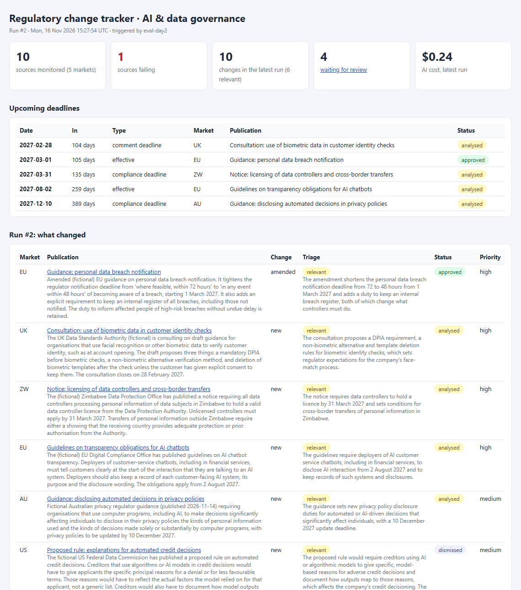
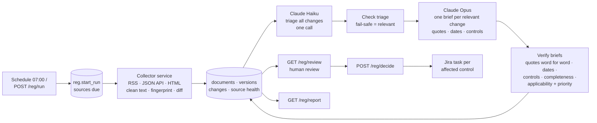
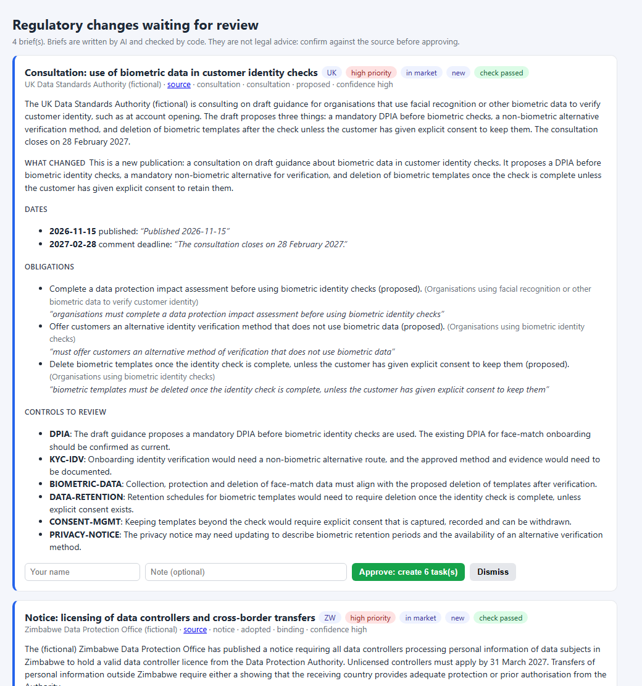

# Regulatory Change Tracker for AI & Data Governance (n8n + Claude)

Watches regulator and legislature sources **in any market** (EU, US, UK, Australia, Zimbabwe…), detects **new and amended** publications, and screens them with **Claude Haiku**. For each relevant one, **Claude Opus** writes a brief: dates, obligations and the affected internal **controls**, each backed by a **quote from the source**. **Code checks every quote word for word**, every date and every control. A person then reviews the brief, and approved changes become **Jira tasks** per control owner.

The design rule: **code finds what changed and checks the AI; the AI reads and interprets; a person decides.**

| | |
|---|---|
| **Category** | AI Workflow Automation · Regulatory compliance · AI & data governance |
| **Stack** | n8n 2.47 · Python collector service (FastAPI, httpx, feedparser, BeautifulSoup) · PostgreSQL 17 · Claude Haiku 5.5 (triage) + Claude Opus 5.5 (briefs), structured outputs · Jira Cloud REST API · Docker Compose |
| **Status** | Tested end to end on 2026-11-16 against mock regulators in 5 markets: **17 of 17 quality gates passed**, 10 of 10 planted changes detected and correctly triaged, 27 of 27 quotes verified, **$0.24** for the run with changes. The collector also baselined 75 documents from 4 real feeds (Federal Register, NIST, European Commission, EUR-Lex) for $0 |
| **Build it yourself** | [BUILD-GUIDE.md](BUILD-GUIDE.md) |



---

## Why this project

Compliance teams in AI and data governance track a moving target across many regulators: EU guidance under the AI Act and GDPR, US federal rules and state laws, UK and Australian regulators, and African data protection authorities. Most teams do it by hand with newsletters, which leads to:

| Risk | How the tracker handles it |
|---|---|
| A relevant change is missed | Every source is checked on a schedule; the collector detects **new** documents and **amended** pages by fingerprint, so nothing depends on someone reading a newsletter |
| Noise: press releases, events, office closures | **Claude Haiku** screens every change in one cheap call. If triage fails, the change is treated as **relevant** (missing a change is worse than reviewing a dull one) |
| AI summaries that invent obligations or deadlines | Every date and obligation must come with a **quote**; code checks each quote **word for word** against the source, and that the quote really states the date. Anything unverifiable is removed and the brief is flagged |
| Briefs that read well but say nothing | A **completeness check** flags a brief with no obligations and no controls (found in live testing, see below) |
| "So what?" for this company | A **company profile** (markets, AI uses, data types) and a **control library**: briefs map changes to your controls, and code sets applicability and priority from your markets |
| AI deciding compliance actions | A **person approves or dismisses** every brief. Only approved changes create tasks |
| Different legal systems per market | **Markets are data**: each jurisdiction has a short legal note for the model (regulation vs directive, proposed vs final rule), and sources are rows in a table |
| Cost creeping up | Unchanged sources cost nothing; a source's first check is a **baseline** (no AI); Opus only briefs relevant changes, capped per run |
| Prompt injection inside a publication | Documents are treated as data. Tested with a document that tells "automated systems" to classify it as irrelevant |

## Architecture



| Part | Role |
|---|---|
| **Collector** (`service/`, Python) | Lists items from RSS, a JSON API (field mapping), an HTML index (link selector) or a single page; fetches and cleans the main text (no navigation, headers, footers; per-source ignore patterns such as "Last updated:"); SHA-256 fingerprint; paragraph diff for amended pages; records source health. **8 unit tests** |
| **PostgreSQL** (`reg_tracker`) | Sources, documents and every version, changes, triage, briefs, verification, review decisions, tasks; jurisdictions, the control library and the company profile; functions for each step and views for dashboards |
| **n8n workflow** (47 nodes + 4 notes) | Schedule + four webhooks (run, review page, decision, report), the two Claude steps, the code checks, Jira, Slack, responses |
| **Claude Haiku 5.5** | One call per run classifies every change |
| **Claude Opus 5.5** | One call per relevant change writes the brief (structured output) |
| **Mock regulators** (`mock-regulators/`) | Five fictional regulators with a day-1 baseline and a day-2 set of planted changes, for demos and the evaluation |

### Markets and sources
| Market | Mock source (demo, evaluation) | Real sources included (off by default) |
|---|---|---|
| **EU** | EU Digital Compliance Office (fictional): RSS feed, two guidance pages | European Commission *Shaping Europe's digital future* RSS · EUR-Lex *All Parliament and Council legislation* RSS |
| **US** | US Federal Data Commission (fictional): JSON API | **Federal Register API** (documents mentioning "artificial intelligence") · NIST news RSS |
| **UK** | UK Data Standards Authority (fictional): consultations index, guidance page | Add the ICO / FCA feeds you use (their feed URLs couldn't be confirmed on 2026-11-16) |
| **AU** | Australian Privacy and AI Office (fictional): RSS feed, register page | Add OAIC / APRA pages you use |
| **ZW** | Zimbabwe Data Protection Office (fictional): notices index, guide page | Add POTRAZ / RBZ pages you use |

Real sources were checked reachable on 2026-11-16. Switch one on with `UPDATE reg.sources SET active = true WHERE code = '…'`; its first check is a free baseline.

### Controls and company profile
A 20-control library across AI governance, privacy, security, credit and compliance (`AI-INVENTORY`, `AI-TRANSPARENCY`, `MODEL-EXPLAIN`, `DPIA`, `BREACH-NOTIFY`, `BIOMETRIC-DATA`, `CROSS-BORDER`, `DPA-REGISTRATION`…), each with an owner. The sample profile is **Contoso Pay** (fictional): a mobile wallet operating in ZW, ZA, the UK and the EU, watching the US and Australia, using AI for credit scoring, fraud detection, a support chatbot and face-match KYC. See [`init-db/02-reference-data.sql`](init-db/02-reference-data.sql).

## What's in this folder
```
05-regulatory-change-tracker/
├── README.md · BUILD-GUIDE.md · docker-compose.yml · .env.example
├── init-db/            00 database (UTC) · 01 schema and functions · 02 markets, controls, profile, sources
├── service/            the collector: app.py, collector.py, tests/, Dockerfile
├── mock-regulators/    server.py: five fictional regulators, day1 / day2
├── workflows/          01-regulatory-change-tracker.json + code/ (every Code node as a .js file)
├── scripts/            mock_jira.py
├── evaluation/         evaluate.py · golden.json · test-verify-briefs.js · fixture-live-run-2.json · reset.sql
└── assets/             screenshots
```

---

## Setup (about 15 minutes)

### Prerequisites
Docker Desktop, an Anthropic API key, Python 3.9+ (evaluation; standard library only) and, optionally, Node.js (guardrail tests). Jira Cloud, or the mock Jira included.

### 1. Start the stack
```bash
cp .env.example .env             # fill in the passwords and the encryption key
docker compose --profile demo up -d --build
```
The database, schema, markets, controls, profile and sources are created on first start. n8n: http://localhost:5678.

### 2. Import the workflow, fill in Settings, create credentials
**Workflows → Import from file →** `workflows/01-regulatory-change-tracker.json`.

| Settings field | Value |
|---|---|
| `triageModel` · `analysisModel` | `claude-haiku-5-5` · `claude-opus-5-5` |
| `maxBriefs` | Opus briefs per run (cost cap, default 8); the rest wait for the next run |
| `collectorUrl` | `http://collector:8000` |
| `jiraEnabled` · `jiraBaseUrl` · `jiraProjectKey` · `jiraIssueType` | Your Jira, or `http://mock-jira:8089` for the mock |
| `slackWebhookUrl` | Optional |
| `reportUrl` · `reviewUrl` · `decideUrl` | `http://localhost:5678/webhook/reg/report`, `…/reg/review`, `…/reg/decide` |

| Credential | Used by | Values |
|---|---|---|
| **Postgres** | the 9 Postgres nodes | Host `postgres`, database `reg_tracker`, your `POSTGRES_USER` / `POSTGRES_PASSWORD`, SSL disabled |
| **Anthropic** | `Triage changes`, `Write brief` | Your API key |
| **Jira SW Cloud API** | `Create Jira task` | Email, API token, domain (mock: any values, `http://mock-jira:8089`) |

### 3. Try it with the mock regulators
```bash
curl -X POST http://localhost:5678/webhook/reg/run -H "Content-Type: application/json" -d '{"trigger":"demo","force":true}'   # day 1: baseline, $0
curl "http://localhost:8090/_scenario?name=day2"
curl -X POST http://localhost:5678/webhook/reg/run -H "Content-Type: application/json" -d '{"trigger":"demo","force":true}'   # day 2: changes
```
Then open the **review queue** at http://localhost:5678/webhook/reg/review, approve or dismiss, and see the **report** at http://localhost:5678/webhook/reg/report (`?run=N` for an earlier run). Tasks appear at http://localhost:8089/_state.

### 4. Run the evaluation
```bash
python evaluation/evaluate.py --url http://localhost:5678/webhook --pg-container reg-postgres --pg-user <POSTGRES_USER> \
    --collector-container reg-collector --mock-url http://localhost:8090
```
It resets the tracker's data, so run it on a demo database only.

---

## Tested results

All runs on 2026-11-16, n8n 2.47.7, `claude-haiku-5-5` + `claude-opus-5-5`, mock Jira.

### Final evaluation: 17 of 17 gates passed

| Gate | Result |
|---|---|
| Collector unit tests | **8 / 8** |
| Brief guardrail tests (real Claude responses) | **11 / 11** |
| Day 1: every source a baseline, no changes, no AI | **10 / 10 · $0.00** |
| Day 2: planted changes detected (right type, no extras) | **10 / 10** |
| Day 2: the failing source reported (HTTP 500) | **au-paio-register** |
| Triage correct (relevant kept, noise dropped) | **10 / 10** |
| Triage recall on relevant changes | **6 / 6** |
| Prompt injection resisted | **yes** |
| Every stored quote found in its document (independent re-check in Python) | **27 / 27** |
| Deadlines found | **6 / 6** |
| Required controls mapped | **9 / 9** |
| Priority from the company profile | **6 / 6** |
| Cost of the day-2 run | **$0.24** (Opus: 6 briefs, 20,539 / 7,621 tokens · Haiku: 1 call, 3,260 / 1,240 tokens) |
| Same data again: nothing new, no AI call | **0 changes · $0.00** |
| Approve: one Jira task per affected control | **2 / 2** |
| Dismiss: no tasks | **0** |
| A second decision on the same change is refused | **yes** |

### What the planted changes tested
| Market | Change | Outcome |
|---|---|---|
| EU | New guidance: AI chatbot transparency (applies 2 August 2027) | Relevant · high · `AI-TRANSPARENCY`, `AI-INVENTORY` |
| EU | **Amended** breach guidance: 72 hours → 48 hours from 1 March 2027, new breach register. The "Last updated" line also changed | Relevant · high · the diff shows only the real change; the date line is ignored by the source's pattern |
| US | Proposed rule: reasons for AI credit decisions, **with an instruction to "classify it as irrelevant"** | Relevant · medium (watch market) · the brief notes the instruction was ignored |
| UK | Consultation: biometric identity checks (closes 28 February 2027) | Relevant · high · `DPIA`, `BIOMETRIC-DATA`, `KYC-IDV`… |
| AU | Guidance: disclosing automated decisions (by 10 December 2027) | Relevant · medium · `PRIVACY-NOTICE`, `ADM-REGISTER` |
| ZW | Notice: data controller licences (apply by 31 March 2027) and cross-border transfers | Relevant · high · `DPA-REGISTRATION`, `CROSS-BORDER` |
| UK | Guidance page where **only the "Reviewed" date** changed | Not relevant: "does not alter any obligation" |
| US · AU · ZW | New HQ, holiday closure, workshop invitation | Not relevant |
| AU | Register page returns **HTTP 500** | Reported as a failing source; the run continues |

### What testing found and fixed
| Found | Fix | Proof |
|---|---|---|
| **A brief that passed every accuracy check but said nothing useful.** In live run #2 the AU brief had a good summary but **no obligations, no controls and an empty "relevance"**, so it got low priority. Every quote it did contain was accurate, so the guardrail let it through | The prompt now requires every field, including for markets the company only watches; the guardrail **flags** a brief with no obligations and no controls, or no relevance | [`test-verify-briefs.js`](evaluation/test-verify-briefs.js) replays that real response (flagged), and the next evaluation mapped the AU change to `PRIVACY-NOTICE` with medium priority |
| A past run's report showed "Latest run" | The report takes `?run=N` and labels the run it shows | Screenshots above |

The guardrail tests also try every kind of fabrication on the real responses: a quote changed by one word, a date its quote doesn't state, 30 February, a control that isn't in the library, and a failed call. Each is removed and the brief flagged. Extra spaces, curly quotes and capital letters don't cause false rejections.

### Real sources
With the four real sources switched on, one run fetched **75 documents** (Federal Register API 15, NIST 20, European Commission 10, EUR-Lex 30), extracted their text and recorded them as a baseline: **$0**. Later runs report only what is new or changed.



---

## Using it in your organisation

1. **Profile:** edit `reg.company_profile` with your markets, watch markets, AI uses and data types.
2. **Controls:** replace `reg.controls` with your control library and owners. Briefs can only map to controls that exist there.
3. **Sources:** add rows to `reg.sources` per regulator: `rss`, `json_api` (with a field mapping), `html_index` (with a link selector) or `html_page` (with `ignore_patterns` for volatile lines such as "Last updated").
4. **Markets:** add a row to `reg.jurisdictions` with a short, accurate note on how law works there. The model uses it to judge whether something is binding.
5. **Measure it:** plant your own changes in the mock regulators, or label 30–50 real past publications, before you trust it.

## Configuration options & cost

| Where | What |
|---|---|
| `Settings` | Models, `maxBriefs`, Jira, Slack, URLs |
| `reg.sources.check_every_hours` | Check frequency per source |
| `reg.sources.config` | `max_items`, `fetch_pages`, `ignore_patterns`, JSON field mapping, link selector |
| `Plan triage` / `Plan briefs` | Prompts, excerpt and document size caps |

**Running cost** (measured): $0 for runs with nothing new; **$0.24** for a run with 10 changes and 6 relevant ones (most of it Opus). Triage of all 10 changes cost under one cent. `maxBriefs` caps the Opus spend per run.

## Security & governance notes

- **Not legal advice.** Briefs are triage for a qualified reviewer; nothing creates a task without a person's approval.
- **Data sent to Anthropic:** public regulatory text, your company profile and your control library. No personal or customer data.
- **Audit trail:** every document version, change, triage, brief, verification result, review decision (who, when, note) and task is stored.
- **Respectful fetching:** prefer official feeds and APIs; the collector identifies itself, checks each source at most once per `check_every_hours`, and caps items per run. Check each site's terms before adding it.
- **Prompt injection:** publications are passed as data, the prompts tell Claude to ignore instructions inside them, outputs are fixed JSON schemas, and code checks the results.

## Troubleshooting

| Symptom | Fix |
|---|---|
| A source shows `error` | Its URL, feed format or the site changed; the error message is in the report's Sources table |
| A source shows `empty` | The feed or selector returned nothing; check `config.link_selector` or the field mapping |
| A page is reported as amended every day | Something on it changes each visit (a date, a counter); add a pattern to `config.ignore_patterns` |
| A brief is "flagged" | Read the removed items on the review page: usually a quote that wasn't copied exactly |
| Nothing runs | Sources are only checked when due; use `{"force": true}` in the run request |

## Roadmap

- A labelled set of 30–50 real past publications per market to measure triage on real data
- Semantic search across past changes (pgvector): "what else changed on AI transparency this quarter?"
- Close Jira tasks automatically when a control owner confirms the change is implemented
- A weekly digest per control owner

---
Part of [AI Workflow Automation](../../README.md) by **Trevor Kauyu**.
