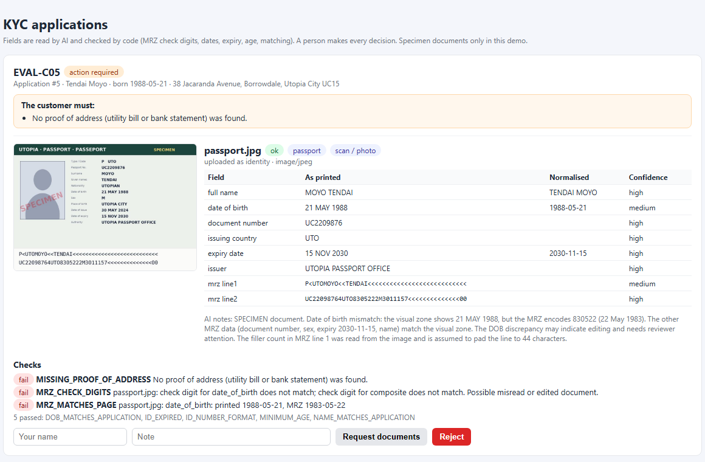
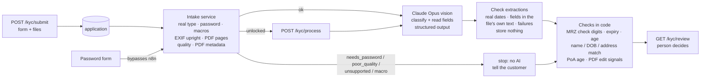
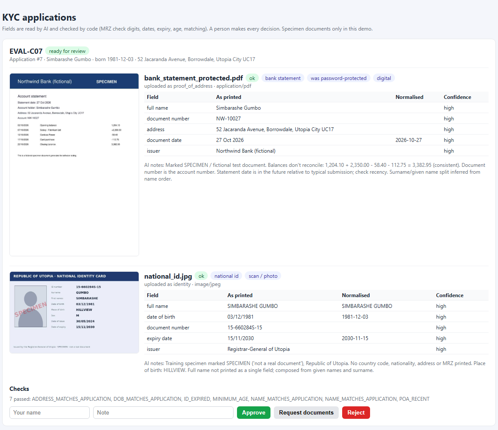

# KYC Document Review with AI Extraction and Human Decision (n8n + Claude)

Reads identity documents and proofs of address **in any form a customer sends them**: phone photos (JPG, PNG, **HEIC**), **scans**, image-only PDFs, digital PDFs and Word files. It handles **password-protected** files safely, stops bad files before any AI call, and lets **Claude** read and classify each document. **Code** then checks everything that can be checked: **passport MRZ check digits**, expiry, age, names, dates of birth and addresses across documents, proof-of-address age, and PDF edit signals. **A person makes every decision.**

The design rule: **code decides what a file is and whether the facts hold up; the AI reads; a person decides.**

| | |
|---|---|
| **Category** | AI Workflow Automation · KYC / onboarding · Document AI · Fraud signals |
| **Stack** | n8n 2.47 · Python intake service (FastAPI, PyMuPDF, Pillow + pillow-heif, OpenCV, filetype, msoffcrypto-tool, python-docx) · PostgreSQL 17 · Claude Opus 5.5 (vision, structured outputs) · Docker Compose |
| **Status** | Tested end to end on 2026-11-16 with 12 specimen applications: **15 of 15 quality gates passed**, **48 of 48 fields read exactly**, every planted problem caught, the password never stored, **about $0.05 per application** (see [Tested results](#tested-results)) |
| **Build it yourself** | [BUILD-GUIDE.md](BUILD-GUIDE.md) |



> **Specimen documents only.** Every document here is generated: the issuing state is "Utopia" (code `UTO`), the fictional specimen state used in the international passport standard (ICAO Doc 9303); people and companies are invented, portraits are silhouettes, and every document is marked SPECIMEN. Never put real identity documents in a repository or a demo.

---

## Why this project

Onboarding teams receive identity documents as blurry phone photos, sideways scans, iPhone HEIC files, password-protected bank statements and the occasional wrong file. Manual checking is slow and inconsistent; "AI KYC" that decides on its own is unauditable and risky. This workflow splits the job:

| Risk | How the workflow handles it |
|---|---|
| Unreadable photos waste reviewer time and AI money | **Intake (code)** scores blur, darkness, glare and resolution on the parts of the image that have content, and stops a bad photo **before any AI call**, with a message the customer can act on |
| Files that aren't what they claim | The real type is read from the file's **bytes**, not its name; a text file renamed `.pdf` is rejected; **macro-enabled Word files are rejected** |
| Password-protected statements (banks often protect them with a name or date of birth) | Detected before extraction (`needs_password`). The reviewer types the customer's password into a form that posts **straight to the intake service, never through n8n**; it's used once and **never stored or logged**; 3 wrong attempts lock the file. No automatic password guessing |
| The AI misreads or invents a value | Dates must be real dates; on digital documents, names, addresses and dates must appear in the file's own text; on passports, the **MRZ check digits** are recomputed: a single misread digit fails the arithmetic |
| Edited documents | MRZ check digits and MRZ-vs-page comparison; PDFs **made or saved with editing tools** or **modified after creation** are flagged for the reviewer, never decided automatically |
| A failed AI call blamed on the customer | A failed, refused or cut-off call stores nothing: the document stays "not read yet" and the application "processing" (found in testing, see below) |
| ID images kept in workflow logs | The workflow and the n8n container **save no execution data** |
| Automated approval | There isn't any. The best outcome is **ready for review**; only a person approves, and only an application with no open customer actions |

## Architecture



| Part | Role |
|---|---|
| **Intake service** (`service/`) | `/intake`, `/documents/{id}/ai-input`, `/validate/{app}`, `/unlock`. File handling with PyMuPDF, Pillow + pillow-heif, OpenCV, filetype, msoffcrypto-tool, python-docx; the passport MRZ in [`mrz.py`](service/mrz.py); every KYC rule in [`validation.py`](service/validation.py). **27 unit tests** |
| **PostgreSQL** (`kyc`) | Applications, documents (originals kept for audit), page images, AI extractions, checks, decisions, an audit log, and the policy settings (minimum age, proof-of-address age, ID number formats per country, suspicious PDF tools) |
| **n8n workflow** (33 nodes + 2 notes) | Submit, process, review page, decisions; the Claude call and the extraction check |
| **Claude Opus 5.5** | One vision call per readable document: type, readability, 15 fields (as printed + normalised + confidence), notes |

### What it accepts
| Input | Handling |
|---|---|
| Phone photos: JPG, PNG, WebP, **HEIC** (iPhone) | Turned upright from EXIF, quality-scored, sent as images |
| Multi-page TIFF (office scanners) | Split into pages |
| **Scanned / image-only PDF** | Pages rendered to images; no text layer, so read from the image |
| Digital PDF | Text extracted and used to **verify** what the model read; page images sent too |
| Word (.docx) | Text and embedded images |
| **Password-protected** PDF or Word | `needs_password`; opened with a person-supplied password via the intake service |
| PDF with print/copy restrictions only | Opens normally; noted |
| Old .doc/.xls, macro-enabled .docm, archives, renamed files | Rejected with a reason |

## What's in this folder
```
06-kyc-document-review/
├── README.md · BUILD-GUIDE.md · docker-compose.yml · .env.example
├── init-db/            00 database (UTC) · 01 schema and functions · 02 policy settings
├── service/            app.py · intake.py · validation.py · mrz.py · tests/ · Dockerfile
├── workflows/          01-kyc-document-review.json + code/ (every Code node as a .js file)
├── scripts/            make_specimens.py: generates the specimen documents and the answer key
├── sample-documents/   12 specimen applications (C01–C12) and cases.json
├── evaluation/         evaluate.py · test-check-extractions.js · fixture-live-c01.json
└── assets/             screenshots
```

---

## Setup (about 15 minutes)

### 1. Start the stack
```bash
cp .env.example .env               # fill in the passwords and the encryption key
docker compose up -d --build
```
n8n: http://localhost:5678 · intake service: http://localhost:8001.

### 2. Import the workflow, fill in Settings, create credentials
**Workflows → Import from file →** `workflows/01-kyc-document-review.json`. It's imported with execution saving switched off; keep it that way.

| Settings field | Value |
|---|---|
| `model` | `claude-opus-5-5` |
| `serviceUrl` | `http://intake:8000` |
| `reviewUrl` · `decideUrl` | `http://localhost:5678/webhook/kyc/review`, `…/kyc/decide` |
| `unlockUrl` | `http://localhost:8001/unlock` (the browser posts passwords here) |

| Credential | Used by | Values |
|---|---|---|
| **Postgres** | the 5 Postgres nodes | Host `postgres`, database `kyc`, your `POSTGRES_USER` / `POSTGRES_PASSWORD`, SSL disabled |
| **Anthropic** | `Extract with Claude` | Your API key |

### 3. Submit an application
```bash
curl -X POST http://localhost:5678/webhook/kyc/submit -H "Content-Type: application/json" -d @application.json
```
with `{"reference": "…", "applicant": {"full_name", "date_of_birth", "address"}, "documents": [{"filename", "declared_type": "identity" | "proof_of_address", "data_b64"}]}`. Open the review page at http://localhost:5678/webhook/kyc/review (`?ref=<reference>` for one application).

### 4. Run the evaluation
```bash
python evaluation/evaluate.py --url http://localhost:5678/webhook --intake-url http://localhost:8001 \
    --pg-container kyc-postgres --pg-user <POSTGRES_USER> --intake-container kyc-intake
```
It resets the KYC data. Regenerate the specimens first if they're more than a couple of months old (their dates are relative to the day they were made):
`docker compose run --rm intake python /scripts/make_specimens.py /specimens`

---

## Tested results

All runs on 2026-11-16, n8n 2.47.7, `claude-opus-5-5`.

### Final evaluation: 15 of 15 gates passed

| Gate | Result |
|---|---|
| Intake service unit tests (MRZ incl. the ICAO specimen passport, intake, validation) | **27 / 27** |
| Intake status of every file | **12 / 12** applications |
| Application status | **12 / 12** |
| Expected failed checks raised (none on clean applications) | **12 / 12** |
| Expected warnings raised | **12 / 12** |
| No AI call for files stopped at intake | **12 / 12** |
| Document type read correctly | **16 / 16** |
| Fields read exactly (name, date of birth, number, expiry, bill date) | **48 / 48** |
| Password flow: wrong refused and counted; right opens, processes, re-checks | **pass** |
| Password never stored in the KYC database (with a "password supplied" audit event) | **0 occurrences** |
| Password never in n8n execution data | **0 occurrences** |
| Approve a clean application | **approved** |
| Approving an application that needs customer action is refused | **refused** |
| A second decision is refused | **refused** |
| AI cost | **$0.60** for 16 documents · **$0.05 per application** |

The extraction guardrail tests (`node evaluation/test-check-extractions.js`, **11 / 11**) were added after this run, using its real Claude responses.

### The 12 specimen applications
| Case | What it tests | Result |
|---|---|---|
| C01 | Passport photo + electricity bill | Ready for review, 0 failures; MRZ read character-perfect, check digits pass |
| C02 | ID photo **saved sideways** (EXIF rotation) + **scanned** statement (no text layer) | Ready for review |
| C03 | **Blurred** ID photo | Stopped at intake: "retake it in focus"; **no AI call** |
| C04 | **Expired** passport | `ID_EXPIRED` |
| C05 | Passport whose **MRZ date of birth was edited** without fixing the check digit | `MRZ_CHECK_DIGITS` and `MRZ_MATCHES_PAGE` fail |
| C06 | Bill in **someone else's name** | `NAME_MATCHES_APPLICATION` fails |
| C07 | **Password-protected** bank statement | `needs_password` → wrong password refused → right password → read → ready for review |
| C08 | **iPhone HEIC** passport + **5-month-old** bill | HEIC read exactly; `POA_RECENT` fails |
| C09 | A **café receipt** as proof of address | Classified `other`: `WRONG_DOCUMENT` |
| C10 | A **text file renamed .pdf** + a **macro** Word file | Both rejected at intake; **no AI call** |
| C11 | Applicant **under 18** | `MINIMUM_AGE` fails |
| C12 | Statement **saved with Photoshop** after it was issued | `PDF_EDIT_SIGNALS` warning for the reviewer |

### What testing found and fixed
| Found | Fix |
|---|---|
| **The API rejected the extraction schema:** structured outputs allow at most 16 nullable fields, and 15 fields × 2 nullable values = 30 | Plain strings with `""` for "not on the document"; the check turns `""` into null |
| **A failed AI call blamed the customer.** It was stored as "the document reads as *other*", so the checks told the customer they had uploaded the wrong document | A failed, refused or cut-off call **stores nothing**: the document stays unread and the application "processing", ready for a re-run. Covered by the guardrail tests |
| **Sharp documents on white paper were rejected.** The first quality check treated blank white paper as "glare", rejecting a clean scanned statement and a receipt photo | Blur and glare are measured only where the page has content; glare isn't scored on scans (it comes from photographing glossy cards). Regression tests for white paper, sharp and blurred |
| **After the right password, processing never started.** The service's `/unlock` made a blocking call to n8n, and n8n's processing calls the same service back: a deadlock | The call runs in a worker thread. The password flow passes end to end |

A note on the AI's notes: on C07, Claude remarked that the statement date (20 days earlier) looked "in the future", a misjudgement of today's date. The proof-of-address age is a code check, which passed correctly. Notes are advice for the reviewer, never a basis for a decision.



---

## Using it in your organisation

1. **Policy:** edit `kyc.settings`: minimum age, proof-of-address age, attempt limit, ID number formats per country and document type, and the PDF tools to flag.
2. **Documents you accept:** the extraction schema and `ID_TYPES` / `POA_TYPES` in `validation.py`.
3. **Tune quality thresholds** (`THRESHOLDS` in `intake.py`) on a sample of your real uploads, in a secure environment.
4. **Measure before trusting:** build a labelled set of your own document types (in a secure environment), and extend `cases.json`.
5. **Connect to case management:** post decisions to your CRM or case tool; keep the audit log.

## Security & privacy notes

- **Identity documents are highly sensitive.** Before production: encrypt stored files (or move them to encrypted object storage), set retention and deletion, restrict database access, and **check your organisation's policy, data-residency rules and your Anthropic agreement** before sending ID images to any AI service.
- **No execution data in n8n:** ID images pass through the workflow, so it saves none (workflow settings and container environment).
- **Passwords:** posted by the reviewer's browser to the intake service; used once to open the file; never written to the database, logs or responses; the audit log records only who supplied one and when. Attempts are limited.
- **No automatic decisions:** AI output is read data and advisory notes; checks are code; decisions are people's, with name, time and note in the audit log.
- **Prompt injection:** document text is passed as data, the prompt tells the model to ignore instructions on the document, and the output is a fixed schema.

## Troubleshooting

| Symptom | Fix |
|---|---|
| A sharp photo is rejected as blurred | Check `quality.blur_score` on the page; tune `THRESHOLDS["blur"]` on your real uploads |
| "processing" never ends | An AI call failed; see `ai_problems` in the response, then `POST /webhook/kyc/process {"application_id": …}` |
| The unlock form doesn't open the file | It's posted to `unlockUrl` (the intake service, port 8001); the attempt counter and lock are in `kyc.documents` |
| `ID_NUMBER_FORMAT` never runs for national IDs | It needs the issuing country code; documents that print only the country name skip it (see roadmap) |
| Large uploads fail | Raise `N8N_PAYLOAD_SIZE_MAX`; the intake service accepts files up to 15 MB |

## Roadmap

- A second, local OCR reading (Tesseract) of critical fields, compared with the AI's reading
- Map printed country names to ISO codes so ID number formats are always checked
- Face match between the ID photo and a selfie, with liveness, from a specialised provider
- Malware scanning of uploads (ClamAV)
- Encrypted object storage and automatic deletion after the retention period

---
Part of [AI Workflow Automation](../../README.md) by **Trevor Kauyu**.
