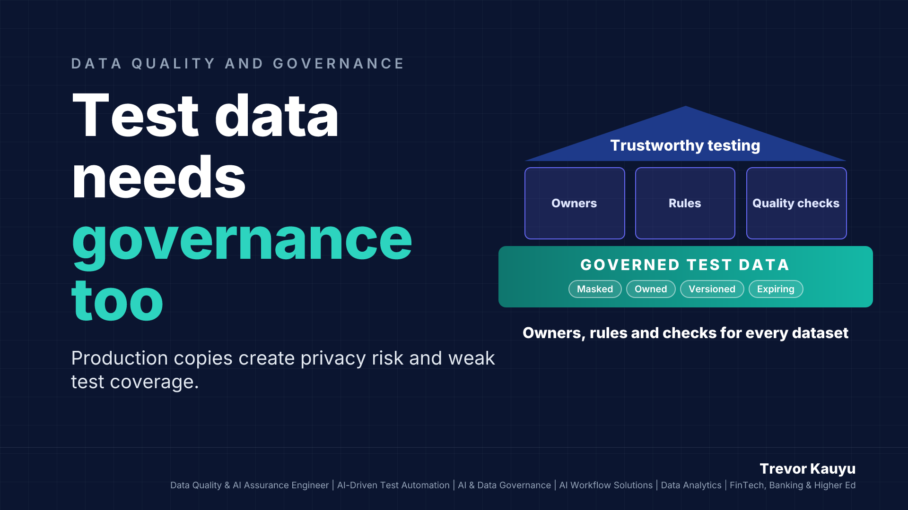
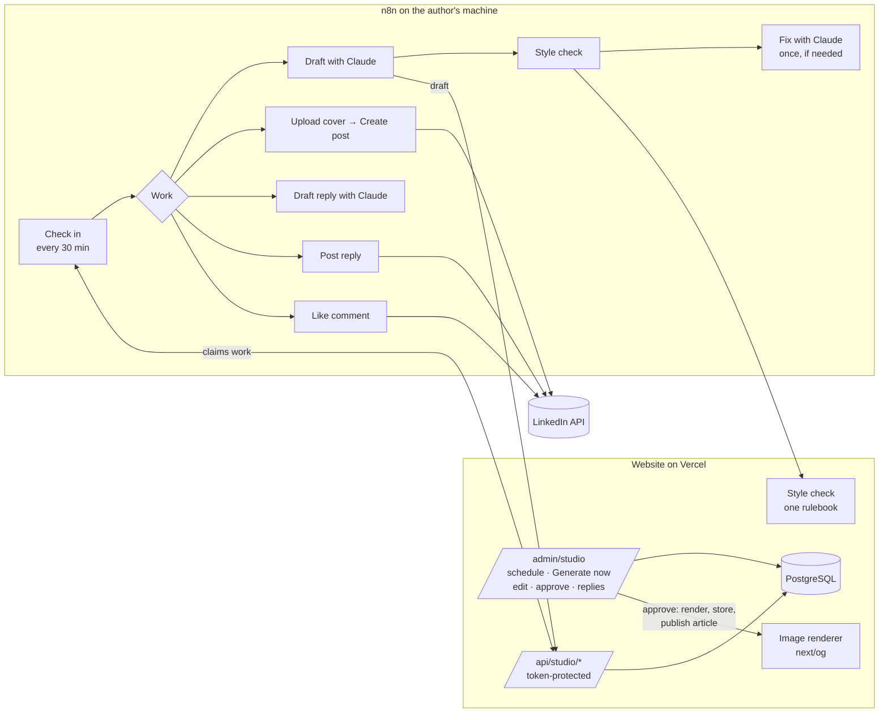
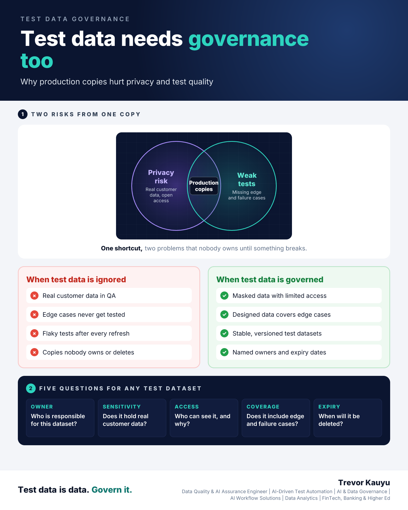

# LinkedIn Content Studio: Posts, Articles, Replies and Likes with a Human Gate (n8n + Claude)

Drafts **LinkedIn posts and full articles in the author's own voice and structure**, draws a **cover image and infographic with the author's name and professional titles in the footer**, publishes the **article on the author's website**, and posts to **LinkedIn** with a link to it. It also drafts **replies to comments** and **likes genuine comments**. Nothing reaches LinkedIn or the website until **a person approves it** in the website's admin panel.

The design rule: **the AI writes; code checks the writing and draws the images; a person approves; the API posts.**

| | |
|---|---|
| **Category** | AI Workflow Automation · Content operations · Human in the loop |
| **Stack** | n8n 2.47 · Claude Opus 5.5 (structured outputs) · Next.js 15 admin + API (the author's website) · Prisma / PostgreSQL · `next/og` image rendering · LinkedIn Posts, Images, Comments and Reactions APIs · Python mock LinkedIn API · Docker Compose |
| **Status** | Tested end to end on 2026-11-16: **20 of 20 quality gates passed**, **36 of 36 offline guardrail tests** on real Claude responses, **33 website unit tests** on the style rules, schedule and LinkedIn links. **About $0.13 per article, $0.05 per post, under $0.01 per reply** (see [Tested results](#tested-results)) |
| **Build it yourself** | [BUILD-GUIDE.md](BUILD-GUIDE.md) |

---

## What it does

| Need | How it works |
|---|---|
| **Daily or custom schedule** | In the admin, pick days, a time and a timezone, how often a draft should be a full article, and a **queue of topics** with short descriptions. When the queue is empty, the AI picks a topic in the author's field that hasn't been covered |
| **Generate on demand** | A **Generate now** button: type a topic and a short description, choose post or article |
| **Same structure as earlier articles** | The author's published articles are sent to Claude as the model to follow, and **code checks the structure**: italic personal opening, short set-up lines, 5 to 7 plain-word sections ending in "Final thought", a bold blockquote line, a list, the infographic's place, and an italic closing question |
| **Sounds human, not AI** | A **style check in code** (one rulebook, shared by n8n and the admin editor) blocks long dashes, about 60 phrases that give AI writing away ("delve", "game-changer", "it's important to note", "Moreover,"…), Markdown on LinkedIn and unfilled placeholders. It warns about buzzword piles, "not just X, but Y", emoji and length. Problems go back to Claude for **one targeted fix**; anything left is shown to the reviewer and **blocks approval** |
| **Images with name and titles** | Claude writes only the words and picks a diagram (Venn, foundation or flow). The website **draws** the cover (1920×1080) and infographic (1600×2000) in the author's existing design, so the text is always spelled right and the footer always carries the exact name and titles |
| **Articles on the website** | Approving an article **publishes it on the website** with its cover and infographic. The LinkedIn post is a link card to it, and the website article gets a "Discuss on LinkedIn" link once it's posted |
| **Human gate** | Every post, article and reply waits in **/admin/studio**. Edit anything (with the style check re-running as you type), regenerate with feedback, reject or approve |
| **Replies to comments** | Claude drafts a short reply in the author's voice, responding to the specific point; **each reply is approved by a person**. Spam and self-promotion get no reply |
| **Likes on comments** | Genuine comments are **liked automatically** (can be switched off); spam is not |

## LinkedIn's API: what is and isn't possible

| | |
|---|---|
| **Posting as yourself** | ✅ "Share on LinkedIn" product (`w_member_social`), available to any developer app |
| **Replying and liking** | ✅ with `w_member_social`, given the comment's ID |
| **Reading comments on your posts** | ⚠️ needs `r_member_social`, which LinkedIn grants only to approved partners. Without it, **paste a comment's link** in the admin ("Copy link to comment"): the link carries the comment's ID, so n8n can still post the approved reply and the like |
| **LinkedIn Articles** (the long-form editor) | ❌ no API. The full article lives on the website, and the LinkedIn post links to it |
| **Scraping** | ❌ never: against LinkedIn's terms, and the account is the author's own |

## Architecture

**Why n8n pulls instead of the website pushing.** The website runs on Vercel and n8n on the author's machine, so the website can't call n8n. Every 30 minutes (07:00 to 22:30) n8n **checks in**: the website runs the schedule, then hands out work and **claims** each piece, so two runs at once can never draft, post, reply or like the same thing twice. A claim older than 30 minutes is treated as abandoned and handed out again. "Generate now" is picked up at the next check-in, or immediately with `POST /webhook/studio/run` on n8n.

**What decides what.**

| Step | Who |
|---|---|
| Schedule, topic queue, claiming, retries (3 at most) | Code (website) |
| Writing the post, article, image text and replies; spam or genuine | Claude |
| Style, structure, LinkedIn limits, placeholders | Code (website): blocks approval |
| Drawing images, name and titles | Code (website) |
| Approving every post, article and reply | **A person** |
| Posting, replying, liking | n8n, via LinkedIn's API. **No retries** on these calls: a post whose answer got lost must not be posted twice |

## The workflow (52 nodes)

| Branch | Nodes |
|---|---|
| **Check in** | Every 30 minutes / Run now → Settings → Check in → (LinkedIn work?) Who am I → Split work → Route work |
| **Draft** | Build draft request → Draft with Claude → Read draft → Check style → Fix needed? → (Build fix request → Fix with Claude → Read fix) or Ready to submit → Submit draft |
| **Reply drafts** | Build reply request → Draft reply with Claude → Read reply → Check reply style → (fix once) → Save reply draft |
| **Publish** | Build image upload → Start image upload → Download cover → Upload cover → Build post → Create post → Read post result → Report post |
| **Reply / Like** | Build reply → Post reply → Report reply · Build like → Like comment → Report like |
| **Read comments** (only with `r_member_social`) | Read comments → Collect comments → Send comments |

Posts use LinkedIn's "little text" format: the code escapes `| { } @ [ ] ( ) < > # \ * _ ~` and turns hashtags into `{hashtag|\#|Tag}` templates, which LinkedIn otherwise cuts off or rejects.

## The website side

Built into the author's portfolio site ([trevor-kauyu.vercel.app](https://trevor-kauyu.vercel.app), private repository) as **Content Studio** in the admin:

| Page | What it does |
|---|---|
| `/admin/studio` | n8n status, next scheduled slot, **Generate now** (topic, description, post or article), drafts to review, in progress, published |
| `/admin/studio/[id]` | Cover and infographic preview, **Approve**, Reject, edit the article, LinkedIn text, tags and image text with the style check live, **Regenerate with feedback**, "Mark as posted" for posting by hand |
| `/admin/studio/comments` | Paste a comment (with its link), approve or edit each reply, skip spam |
| `/admin/studio/settings` | Schedule days, time, timezone, format mix, auto-like, **voice notes** for the AI, the name and titles on images, the topic queue |

| Endpoint (bearer token) | Used by n8n to |
|---|---|
| `GET /api/studio/jobs` | check in: run the schedule, claim work, get the writing context |
| `POST /api/studio/lint` | run the style check on a draft or reply |
| `POST /api/studio/items/{id}` | submit a draft, report a failure, report a post |
| `POST /api/studio/comments`, `POST /api/studio/comments/{id}` | add comments read from LinkedIn; save a reply draft, report a reply or like |
| `GET /api/studio/image/{id}/{cover\|infographic}` | render a draft's image (also the admin preview) |
| `POST /api/studio/requests`, `GET /api/studio/items/{id}` | queue a draft, read an item (tests, shortcuts). **There is no approval endpoint**: approval needs the admin login |

## Tested results

Tested on 2026-11-16 against the website (local), n8n and the [mock LinkedIn API](mock-linkedin/server.py), which checks requests the way LinkedIn does (version headers, image uploaded before the post, escaped text, reply threading) and puts four comments on every new post: two genuine, one spam, one by the author. **[evaluation/evaluate.py](evaluation/evaluate.py)** runs in three phases, with a person approving in between, exactly as in real use:

| Phase | Gates | Result |
|---|---|---|
| **Drafts:** one article ("Test data is a data governance problem") and one post | both arrive · no blocking style problem · no long dashes · none of the common AI phrases (an independent list) · article structure matches the earlier articles · post rules · on topic · images render at the right sizes · cost | **9 / 9** |
| **Posting:** after approval | both live on LinkedIn · exactly one post each · article live on the website with infographic and LinkedIn link · link card with hashtag templates · comments read once, author's own ignored · spam not replied to or liked, genuine comments liked and replied to · replies pass the style check | **7 / 7** |
| **Replies:** after approval | every approved reply posted · once, under the right comment · another run posts nothing new · whole run under $1 | **4 / 4** |

| Cost (Claude Opus 5.5, $4 / $20 per million tokens) | |
|---|---|
| Article (732 words) + its LinkedIn post + cover + infographic | **$0.131** |
| LinkedIn post + cover | **$0.049** |
| Reply draft | **$0.006 to $0.008** |
| Whole evaluation run (article, post, 6 reply drafts) | **$0.223** |

Both drafts passed the style check on the first try, so the fix pass didn't run (it's covered by the offline tests). A sample article ([cover](assets/article-cover.png), [infographic](assets/article-infographic.png)) and post ([cover](assets/post-cover.png)) from the run are in [assets/](assets/).

**Offline guardrail tests** ([evaluation/test-guardrails.js](evaluation/test-guardrails.js)) replay the real Claude responses from the first live run ([fixture](evaluation/fixture-live-run-1.json)) through the Code nodes, with no API calls: 36 tests covering failed, cut-off and invalid answers (reported, never stored as drafts), diagram fallbacks, LinkedIn text escaping with every reserved character, failed uploads stopping the post, 409 on likes, the author's own comments and nested replies skipped, and LinkedIn work waiting when the identity call fails.

### What testing found

- **Replies claimed experience the author never described.** A reply said "What's worked for me is…", which the post and notes didn't support. The prompt now asks for suggestions ("One thing that helps is…") unless the experience is in the post or the author's notes; the next run's replies followed it.
- **Two gates could pass with nothing to check.** In one run, the mock reused post IDs after a reset, so the website (correctly) ignored the "new" comments as duplicates, and the spam and reply-style gates passed on zero comments. The mock's IDs are now never reused, like LinkedIn's, and those gates require the comments to exist.
- **Image layouts, checked by eye.** The Venn diagram's labels were unreadable on the infographic's light panel, and the closing line lost a space between differently coloured words. Both fixed before the live run.

## Run it

See **[BUILD-GUIDE.md](BUILD-GUIDE.md)**: website settings and migration, n8n credentials, testing against the mock, the evaluation, and connecting a real LinkedIn app.

## Files

| Path | What it is |
|---|---|
| `workflows/01-linkedin-content-studio.json` | the n8n workflow (import into n8n) |
| `workflows/code/*.js` | the Code nodes, one file each, with comments |
| `mock-linkedin/server.py` | mock LinkedIn API for testing (standard library only) |
| `evaluation/evaluate.py` | live evaluation, 20 gates in 3 phases |
| `evaluation/test-guardrails.js`, `fixture-live-run-1.json` | offline tests on real Claude responses |
| `docker-compose.yml`, `.env.example` | n8n, its database and the mock |
