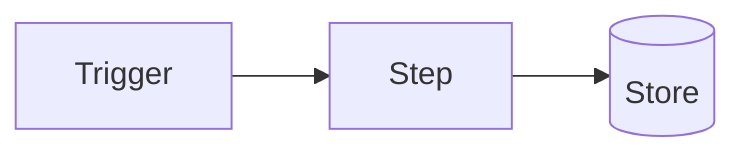

# <Project name>

<One-sentence description of what it does and for whom.>

| | |
|---|---|
| **Category** | AI Workflow Automation · <sub-type, e.g. Document extraction> |
| **Stack** | <tools and versions> |
| **Status** | <Prototype / Tested on DATE with MODEL> |

## Why this project
<The business problem, what goes wrong today, and how this workflow fixes it. Include a risk → mitigation table.>

## Architecture


## What's in this folder
```
NN-project-name/
├── workflows/
├── evaluation/
└── ...
```

## Setup
### Prerequisites
### 1. Start the stack
### 2. Import the workflows
### 3. Create the credentials
### 4. Run it

## Evaluation
<How to run the tests, what each metric means, and the quality gates. Real results only, with date and model.>

## Configuration options & cost

## Security & governance notes

## Troubleshooting

## Roadmap

---
Part of [AI Workflow Automation](../../README.md) by **Trevor Kauyu**.
